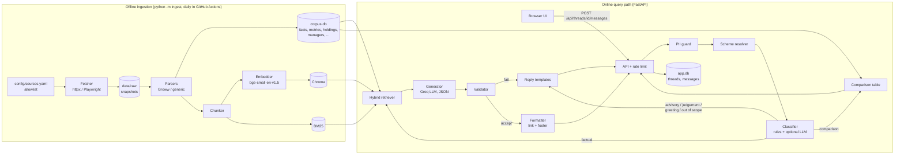
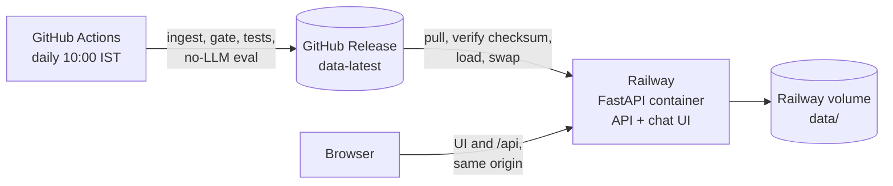

# Mutual Fund FAQ Assistant

> **Facts-only. No investment advice.**

A retrieval-augmented (RAG) chatbot that answers objective questions about 19 Indian mutual fund schemes. Every answer is drawn from a fixed list of source pages and cites its source. The assistant refuses to give advice, judge performance or handle personal data.

Users ask questions like *"What is the exit load of Kotak Multi Cap Fund?"* or *"How do I download my capital gains statement?"*. The reply is at most three sentences with one source link and a `Last updated from sources: <date>` footer.

---

## Contents

1. [Overview](#1-overview)
2. [Problem statement and objectives](#2-problem-statement-and-objectives)
3. [Key features](#3-key-features)
4. [Covered schemes and sources](#4-covered-schemes-and-sources)
5. [Technology stack](#5-technology-stack)
6. [System architecture](#6-system-architecture)
7. [Project structure](#7-project-structure)
8. [Key modules](#8-key-modules)
9. [Getting started](#9-getting-started)
10. [Configuration](#10-configuration)
11. [Deployment and daily data refresh](#11-deployment-and-daily-data-refresh)
12. [Testing and evaluation](#12-testing-and-evaluation)
13. [Known limitations](#13-known-limitations)
14. [Future scope and open work](#14-future-scope-and-open-work)
15. [Further documentation](#15-further-documentation)

---

## 1. Overview

| | |
|---|---|
| **What it is** | A web chat app (FastAPI backend and a plain HTML/JS frontend) that answers factual mutual fund questions from a curated corpus |
| **Who it is for** | Retail investors looking up scheme facts, and support or content teams that handle repetitive mutual fund questions |
| **What it answers** | Scheme facts (expense ratio, exit load, minimum SIP, lock-in, riskometer, benchmark, fund managers), published figures (returns, NAV, AUM, ranks, risk ratios, holdings), general concepts (ELSS lock-in, SIP, riskometer) and statement or capital-gains download steps |
| **What it refuses** | Advice ("should I invest?"), performance judgements ("is it doing well?"), verdict comparisons ("which is better?"), projections and calculations, and any message containing personal data |
| **Status** | Phases 0 to 11 of the [implementation plan](docs/implementation-plan.md) are built and tested. Phase 12 (documentation and release) is in progress. See [§14](#14-future-scope-and-open-work) |

**Guiding principle: accuracy over intelligence.** When the system isn't sure, it says so and links the most relevant source rather than guessing. Structured facts are used before free text, rule-based checks before LLM judgement, and a validator can reject the model's output.

---

## 2. Problem statement and objectives

The brief ([docs/problemStatement.md](docs/problemStatement.md)) asks for a lightweight RAG assistant that:

- answers factual mutual fund queries from a curated corpus of public pages;
- keeps every answer to 3 sentences or fewer, with exactly one source link and a "last updated" date;
- politely refuses advisory questions and links to investor-education material;
- never collects or stores PAN, Aadhaar, account numbers, OTPs, emails or phone numbers;
- supports several independent chat threads;
- shows a welcome message, three example questions and the disclaimer "Facts-only. No investment advice."

### Deliberate departures from the brief

The problem statement asks for one AMC, 3 to 5 schemes and official sources only (AMC, AMFI, SEBI). This project departs from those lines on purpose. The reasoning is recorded in [docs/architecture.md §2.3–2.4](docs/architecture.md).

| Brief | This project | Why |
|---|---|---|
| One AMC, 3 to 5 schemes | **19 schemes across 8 AMCs** | These are the 19 Groww reference pages supplied with the brief |
| Official sources only, no aggregators | **Scheme answers cite the scheme's Groww page** (`citation_policy: groww` in [config/settings.yaml](config/settings.yaml)) | The Groww pages are both the source of the facts and the citation. General, statement and refusal answers still cite AMFI, SEBI or CAMS pages |
| "No performance comparisons or return calculations"; "link to the factsheet only" | **Published figures are stated as facts**, always with their basis (annualised, absolute or SIP) and as-of date | Read as forbidding *interpretation and computation*, not the restatement of published data. The assistant never judges, ranks, recommends or computes its own figures |

Groww is an aggregator, so its figures may lag AMC factsheets, KIMs and SIDs. The footer date shows when the cited page was last fetched.

---

## 3. Key features

### Implemented

| Feature | What the user sees | What happens behind the scenes | Main modules |
|---|---|---|---|
| **Factual answers with one citation** | A short answer, a "Source" link and a "Last updated from sources" date | Structured facts are looked up first, then hybrid text search. One Groq LLM call returns JSON naming the evidence block it used. The link and date come from that block, never from the model | `retriever.py`, `generator.py`, `formatter.py` |
| **Published figures** | "The 3-year annualised return of X was +N% as of <date>, as published by Groww." | Figures are read from the `scheme_metrics`, `scheme_holdings` and `fund_managers` tables with their label, basis and as-of date. The validator checks that every number in the answer appears in the evidence | `retriever.py`, `validator.py` |
| **Side-by-side comparison (2 to 4 schemes)** | "Compare the expense ratio and NAV of X and Y" returns a table with one column per scheme | Built straight from the facts and metrics tables, with **no LLM**. Columns keep the order named and are never sorted or highlighted. Each column cites its own scheme page | `comparison.py` |
| **Advisory and judgement refusals** | A polite refusal with an AMFI or SEBI education link (advice) or the scheme's Groww page (performance judgement) | Regex rules catch clear phrasings, and an optional LLM classifier gives a second opinion. When they disagree, the more restrictive class wins | `classifier.py`, `templates.py` |
| **PII guard** | Messages with personal details get a fixed privacy notice | Regexes for PAN, Aadhaar, phone, email, OTP and account or folio numbers run *before* anything is stored, logged or sent to the LLM. The thread stores only a placeholder | `pii_guard.py`, `pii_patterns.py` |
| **Scheme name resolution** | Old names, short forms and typos work ("HDFC Equity Fund", "PPFAS", "kotak mutli cap"). Ambiguous names get a clarifying question | Exact aliases from [config/aliases.yaml](config/aliases.yaml), token-level fuzzy matching (`rapidfuzz`), AMC and category handling. Uncovered schemes get "not covered" | `scheme_resolver.py` |
| **Follow-up questions** | "and its benchmark?", "what about Bandhan Small Cap?", "the ICICI one" | Each thread stores its active scheme, the candidates from the last clarifying question, and the last question's intent | `orchestrator.py`, `store/threads.py` |
| **Multiple chat threads** | A sidebar of conversations: new, switch, delete, rename, pin, export to Markdown, collapsible sidebar (Ctrl+B) | Threads are server-side (SQLite). The browser keeps only thread ids and titles in `localStorage`. Pins are browser-only. A per-thread lock keeps messages in order while different threads run in parallel | `api/threads.py`, `api/deps.py`, `frontend/app.js` |
| **Template fallback** | Common questions still get correct answers when the LLM is down, rate-limited or not configured | Deterministic fact, metric and holdings templates. Without `GROQ_API_KEY` the app runs in "limited mode" | `templates.py`, `orchestrator.py` |
| **Health and status** | A status card in the UI: sources indexed, limited mode, stale sources, or server unreachable | `GET /api/health` reports index status, LLM status, per-source fetch dates and bundle freshness | `api/meta.py`, `frontend/app.js` |
| **Daily data refresh** | Footer dates stay current | A GitHub Actions workflow re-ingests every source daily, runs a quality gate and publishes a data bundle as a GitHub Release. The server pulls it, verifies it and hot-swaps the corpus with no restart | `.github/workflows/daily-ingest.yml`, `ingest/bundle.py`, `ingest/gate.py`, `app/jobs.py` |
| **Operations hardening** | — | Per-IP rate limit on message posts, JSON logs that never contain message text, a thread retention job (30 days), a daily summary log line, and degraded start-up with no corpus | `middleware/rate_limit.py`, `observability.py`, `jobs.py`, `bootstrap.py` |
| **Production hosting on Railway** | The whole app (API and chat UI) at one Railway URL | One Docker container serves the API and the static UI from the same origin, and redeploys on every push to `main`. UI files are sent with `Cache-Control: no-cache`, so browsers pick up a new `app.js` after each deploy | `Dockerfile`, `railway.json`, `app/main.py` |

### Partially implemented

| Item | Current state |
|---|---|
| **Release evaluation** | The golden set has 150 cases. The last full real-API run did not meet the factual (86%) and follow-up (80%) gates. Failing cases were fixed and pass in targeted re-runs, but a clean full run with all fixes is still to do. See [§12](#12-testing-and-evaluation) |

### Not implemented (by design)

User accounts or login, personalised advice, portfolio analysis, transactions, live NAV tracking, computed returns or projections, and languages other than English.

---

## 4. Covered schemes and sources

All URLs are listed in one allowlist, [config/sources.yaml](config/sources.yaml) (38 sources). No URL outside this file is ever fetched or cited.

### Scheme pages (19 Groww pages, cited for scheme answers)

| AMC | Scheme (Direct – Growth) | Category |
|---|---|---|
| HDFC | [HDFC Flexi Cap Fund](https://groww.in/mutual-funds/hdfc-equity-fund-direct-growth) | Equity – Flexi Cap |
| HDFC | [HDFC Silver ETF FoF](https://groww.in/mutual-funds/hdfc-silver-etf-fof-direct-growth) | FoF – Commodity |
| HDFC | [HDFC Pharma And Healthcare Fund](https://groww.in/mutual-funds/hdfc-pharma-and-healthcare-fund-direct-growth) | Equity – Sectoral |
| HDFC | [HDFC NIFTY Next 50 Index Fund](https://groww.in/mutual-funds/hdfc-nifty-next-50-index-fund-direct-growth) | Index |
| HDFC | [HDFC Corporate Bond Fund](https://groww.in/mutual-funds/hdfc-medium-term-opportunities-fund-direct-growth) | Debt – Corporate Bond |
| Aditya Birla Sun Life | [ABSL Flexi Cap Fund](https://groww.in/mutual-funds/birla-sun-life-equity-fund-direct-growth) | Equity – Flexi Cap |
| Aditya Birla Sun Life | [ABSL Large Cap Fund](https://groww.in/mutual-funds/aditya-birla-sun-life-large-cap-direct-fund-growth) | Equity – Large Cap |
| Aditya Birla Sun Life | [ABSL Multi Cap Fund](https://groww.in/mutual-funds/aditya-birla-sun-life-multi-cap-fund-direct-growth) | Equity – Multi Cap |
| Aditya Birla Sun Life | [ABSL Small Cap Fund](https://groww.in/mutual-funds/birla-sun-life-small-midcap-fund-direct-growth) | Equity – Small Cap |
| Aditya Birla Sun Life | [ABSL BSE Total Market Index Fund](https://groww.in/mutual-funds/aditya-birla-sun-life-bse-total-market-index-fund-direct-growth) | Index |
| Aditya Birla Sun Life | [ABSL Credit Risk Fund](https://groww.in/mutual-funds/birla-sun-life-corporate-bond-fund-direct-growth) | Debt – Credit Risk |
| Aditya Birla Sun Life | [ABSL Corporate Bond Fund](https://groww.in/mutual-funds/birla-sun-life-short-term-fund-direct-growth) | Debt – Corporate Bond |
| Nippon India | [Nippon India Large Cap Fund](https://groww.in/mutual-funds/nippon-india-large-cap-fund-direct-growth) | Equity – Large Cap |
| ICICI Prudential | [ICICI Prudential Large Cap Fund](https://groww.in/mutual-funds/icici-prudential-large-cap-fund-direct-growth) | Equity – Large Cap |
| ICICI Prudential | [ICICI Prudential Corporate Bond Fund](https://groww.in/mutual-funds/icici-prudential-corporate-bond-fund-direct-plan-growth) | Debt – Corporate Bond |
| PPFAS | [Parag Parikh Flexi Cap Fund](https://groww.in/mutual-funds/parag-parikh-long-term-value-fund-direct-growth) | Equity – Flexi Cap |
| Bandhan | [Bandhan Small Cap Fund](https://groww.in/mutual-funds/bandhan-small-cap-fund-direct-growth) | Equity – Small Cap |
| Kotak | [Kotak Multi Cap Fund](https://groww.in/mutual-funds/kotak-multi-cap-fund-direct-growth) | Equity – Multi Cap |
| Edelweiss | [Edelweiss Mid Cap Fund](https://groww.in/mutual-funds/edelweiss-mid-and-small-cap-fund-direct-growth) | Equity – Mid Cap |

Several Groww URL slugs are legacy names that now open a different scheme. For example, `birla-sun-life-short-term-fund` is the ABSL Corporate Bond Fund. The names above follow the live pages. See [docs/corpus-review.md](docs/corpus-review.md).

### Supporting official pages (19, cited for general, statement and refusal answers)

| Type | Count | Examples |
|---|---|---|
| AMFI (Mutual Funds Sahi Hai, amfiindia.com) | 13 | What is a SIP, ELSS lock-in, riskometer, exit load and redemption costs, glossary, comparing scheme performance |
| SEBI investor pages | 4 | Consolidated account statement (CAS), securing your investment account |
| CAMS (registrar) help pages | 2 | CAS request, capital gain/loss statement |

There is no ELSS scheme in the list, so ELSS questions are answered from the general AMFI pages.

---

## 5. Technology stack

| Layer | Technology | Notes |
|---|---|---|
| Language | Python ≥ 3.11 (Docker and CI use 3.12) | Package metadata in [pyproject.toml](pyproject.toml) |
| API server | FastAPI + Uvicorn | Async handlers. The OpenAPI docs are at `/docs` |
| Frontend | Plain HTML, CSS and vanilla JavaScript | No build step. Served by FastAPI from the same origin as the API |
| Fetching | `httpx` (static pages); Playwright headless Chromium (pages rendered client-side: the AMFI glossary and the CAMS pages) | Polite fetcher: rate limit, retries, robots.txt |
| Parsing | `selectolax`, BeautifulSoup, `pdfplumber` | Groww facts come from the page's embedded `__NEXT_DATA__` JSON |
| Relational storage | SQLite via SQLAlchemy (WAL mode) | Two databases: `corpus.db` (facts) and `app.db` (threads) |
| Vector index | Chroma (persistent, local, cosine) | Embeddings are always supplied by the app |
| Keyword index | `rank_bm25` | Pickled next to Chroma |
| Embeddings | `BAAI/bge-small-en-v1.5` via `sentence-transformers` (runs locally on CPU) | The query instruction is added to queries only |
| LLM | Groq (`groq` SDK), model `openai/gpt-oss-120b`, temperature 0, strict JSON-schema output | The model id is a single config value. Optional: the app works without it |
| Fuzzy matching | `rapidfuzz` | Scheme name typos |
| Configuration | `pydantic-settings` + YAML | `config/settings.yaml`, with secrets from the environment |
| Background jobs | APScheduler (in-process) | Corpus reload, bundle pull, retention, daily summary |
| CI and data pipeline | GitHub Actions + GitHub Releases | Daily ingest, quality gate, bundle publish |
| Hosting | Railway (one Docker container serving the API and the UI) | See [§11](#11-deployment-and-daily-data-refresh) |
| Tooling | `pytest`, `pytest-asyncio`, `ruff` | `pip install -e ".[dev]"` |

---

## 6. System architecture

The system has two halves: an **offline ingestion pipeline** that builds the corpus, and an **online query pipeline** that answers one message at a time.



### 6.1 Offline ingestion

`python -m ingest` (code in [backend/ingest/](backend/ingest/)) runs these steps in order:

1. **Fetch.** Each allowlisted URL is fetched politely and saved to `data/raw/<source_id>/<date>.html`. A failed fetch writes nothing, so the previous snapshot and its date stay in use. Block or CAPTCHA pages are rejected by a content check.
2. **Parse.** Groww pages produce core facts (`scheme_facts`) and everything else the page publishes (metrics, holdings, peers, fund managers, history, attributes). AMFI, SEBI and CAMS pages produce readable sections. Fields that can't be found are left empty, never guessed. Groww's own "pros/cons" opinions are stored but flagged and never used as evidence.
3. **Chunk.** One chunk per section, split above 350 tokens. Each chunk gets a header with the scheme or page name. Holdings and similar-fund sections are not indexed as text because they are answered from SQL. Navigation, stubs and any section containing personal data are dropped.
4. **Index.** Chunks are embedded into Chroma and a BM25 index is rebuilt. Indexing is incremental: a source is re-embedded only when its chunks change. An index manifest forces a full rebuild if the model or chunker version changes.

### 6.2 Online query pipeline

Orchestrated by [backend/app/pipeline/orchestrator.py](backend/app/pipeline/orchestrator.py). Each step can end the pipeline early with a template reply.

| Step | What it does |
|---|---|
| 1. PII guard | Blocks the message before it is stored, logged or sent anywhere. The thread stores `[message withheld: contained personal information]` |
| 2. Scheme resolver | Maps the wording to 0, 1 or several schemes (clarifying reply, alias, fuzzy, AMC, category or thread context) and detects which field or metric is asked |
| 3. Classifier | Assigns one of these classes: `factual_scheme`, `factual_metric`, `factual_general`, `comparison`, `advisory`, `performance_judgement`, `out_of_scope` or `greeting`. Rules decide first. A Groq call gives a second opinion when the rules aren't decisive |
| 4. Retriever | Structured evidence first (facts, metrics, holdings, managers), then Chroma top 8 + BM25 top 8 merged with Reciprocal Rank Fusion (top 5 kept). A **no-evidence rule** (relevance floor plus content-word check) stops generation when nothing relevant was found |
| 5. Generator | One Groq call returns `{answer, evidence_id, answerable}`. The model never writes URLs or dates |
| 6. Validator | Deterministic checks: schema, evidence id, ≤ 3 sentences, no URLs, no advice or judgement wording, every figure present in the evidence, basis and as-of date stated, consistency with stored facts. Failures get one retry, then the template fallback |
| 7. Formatter | Adds `Source: <url>` and `Last updated from sources: <date>` from the cited evidence block |

**Reply types** (the `type` field in the API response): `answer`, `comparison`, `greeting`, `advisory_refusal`, `performance_refusal`, `out_of_scope`, `not_covered`, `plan_not_covered`, `no_evidence`, `clarify`, `pii_blocked`, `unavailable`, `corpus_unavailable`.

### 6.3 LLM integration

- **Provider and model:** Groq, `openai/gpt-oss-120b`, temperature 0, low reasoning effort, strict JSON schema. Set in `llm:` in [config/settings.yaml](config/settings.yaml).
- **Uses:** (a) answer generation and (b) the optional classifier second opinion. Comparison tables, refusals, greetings and PII replies never call the LLM.
- **Prompting:** A fixed system prompt, numbered evidence blocks, and a "Resolved: <scheme>; asked about: <field>" note. Conversation history is sent only when the question depends on it (a pronoun or an elliptical follow-up).
- **Rate limits:** A shared client-side limiter keeps within the Groq account limits (30 requests/min, 8K tokens/min, 1K requests/day, 200K tokens/day by default). It also caps concurrent calls and retries once on 429 or 5xx. When the budget runs out, the deterministic templates answer instead.
- **Without a key:** If `GROQ_API_KEY` is unset, the app still runs. Answers come from fact and metric templates, and the UI shows "Limited mode".

### 6.4 Data storage

| Store | Location | Contents |
|---|---|---|
| `corpus.db` (SQLite) | `data/` or the active bundle in `data/bundles/<id>/` | `sources`, `scheme_facts`, `scheme_snapshots`, `scheme_metrics`, `scheme_holdings`, `scheme_peers`, `fund_managers`, `scheme_history`, `scheme_attributes`, `scheme_analysis` |
| `app.db` (SQLite) | `data/app.db` | `threads` (title, active scheme, pending candidates, last intent) and `messages` (PII-free text, reply type, citation, date, comparison table) |
| Chroma | `chroma/` next to `corpus.db` | Chunk embeddings and metadata |
| BM25 | `bm25.pkl` next to `corpus.db` | Keyword index and chunk list |
| Manifests | `index_manifest.json`, `bundle.json` | Index settings, build time, and bundle checksums |

All of `data/` is git-ignored. Conversations are kept apart from the corpus: bundle packing refuses a database that contains thread tables.

### 6.5 API

All routes are under `/api`. The full schema is at `/docs` when the server is running.

| Method | Path | Purpose |
|---|---|---|
| `POST` | `/api/threads` | Create a thread → `{id, created_at}` |
| `GET` | `/api/threads/{id}` | Thread title and full message history |
| `PATCH` | `/api/threads/{id}` | Rename a thread (the title goes through the PII guard) |
| `DELETE` | `/api/threads/{id}` | Delete a thread and its messages |
| `POST` | `/api/threads/{id}/messages` | Send `{content}` (1–500 characters) → reply with `type`, `answer`, `citation_url`, `last_updated`, `rendered` and optionally `comparison`. Rate limited per IP (20/min) |
| `GET` | `/api/meta` | Welcome text, example questions, disclaimer, PII notice and the covered schemes |
| `GET` | `/api/health` | `ok` or `degraded`, index and LLM status, per-source fetch dates, stale sources, and corpus or bundle information |

### 6.6 Authentication and privacy

- **There is no authentication.** The assistant is anonymous by design. A thread is reachable only by its random UUID, which the browser keeps in `localStorage`. There is no "list all threads" endpoint.
- **Privacy controls:** The PII guard runs on every message and thread title. Logs contain whitelisted fields only (ids, route, scores, latency, token counts) and never message text. Exceptions are logged as type and location only.
- **Secrets:** `GROQ_API_KEY` and `DATA_REFRESH_TOKEN` are read from the environment or `.env` (git-ignored) and never sent to the frontend.
- **Citation integrity:** URLs come only from `sources.yaml`, through the evidence block the model names.
- **CORS** is restricted to the configured frontend origins.

---

## 7. Project structure

```
.
├── backend/
│   ├── app/                      # Online service (FastAPI)
│   │   ├── main.py               # App factory, middleware, routes, static UI mount, start-up
│   │   ├── config.py             # Typed settings: YAML + environment variables
│   │   ├── api/                  # HTTP routes: threads, messages, meta/health; schemas; deps
│   │   ├── pipeline/             # The answer pipeline (see §8)
│   │   ├── store/                # SQLAlchemy models, engine setup, thread repository
│   │   ├── middleware/           # Per-IP rate limiter
│   │   ├── jobs.py               # Background jobs: corpus reload, bundle pull, retention, summary
│   │   ├── corpus.py             # Finds the active corpus folder (data/ or a pulled bundle)
│   │   ├── bootstrap.py          # Installs the first data bundle on an empty server volume
│   │   ├── observability.py      # JSON logging (no message text), daily counters
│   │   └── cli.py                # Ask questions from the terminal
│   ├── ingest/                   # Offline ingestion
│   │   ├── __main__.py           # `python -m ingest`: fetch → parse → chunk → index
│   │   ├── fetcher.py            # Polite httpx / Playwright fetcher, snapshots
│   │   ├── parsers/              # groww.py (core facts), groww_extended.py (everything else), generic.py
│   │   ├── pipeline.py           # Fetch → parse → store into corpus.db
│   │   ├── normalise.py          # Value parsing helpers (return None rather than guess)
│   │   ├── chunker.py            # Section-based chunker
│   │   ├── indexer.py            # Embeddings, Chroma, BM25, index manifest
│   │   ├── gate.py               # Quality gate for the daily refresh
│   │   ├── bundle.py             # Pack, unpack, verify and install data bundles
│   │   ├── check_sources.py      # Validates the config/ YAML files
│   │   └── facts_report.py       # Prints stored scheme data for manual review
│   └── tests/                    # pytest suite (~1,000 tests) with HTML fixtures and a fake Groq client
├── frontend/                     # Chat UI: index.html, app.js, styles.css, config.js (API base URL)
├── config/
│   ├── settings.yaml             # All runtime settings (development)
│   ├── settings.production.yaml  # Railway settings (selected with APP_SETTINGS_FILE)
│   ├── sources.yaml              # URL allowlist: 19 scheme pages and 19 official pages
│   ├── aliases.yaml              # AMC and scheme aliases, old names
│   └── education_links.yaml      # Topic → educational source used in refusals
├── eval/
│   ├── golden.yaml               # 150 golden cases across 8 buckets
│   ├── run.py, checks.py         # Evaluation runner and per-reply checks
│   ├── verify_golden.py          # Checks expected values against raw page snapshots
│   ├── tune.py                   # Threshold sweeps (relevance floor, fuzzy matching)
│   ├── research/                 # Chunking and retrieval benchmarks (design research)
│   └── results/                  # Saved evaluation runs (JSON)
├── docs/                         # Problem statement, architecture, plans, research and reviews
├── .github/workflows/daily-ingest.yml   # Daily ingest → gate → publish bundle
├── Dockerfile, .dockerignore, railway.json   # API container for Railway
├── pyproject.toml                # Dependencies, pytest and ruff config
├── .env.example                  # Environment variable template
├── data/                         # Runtime data (git-ignored): snapshots, databases, indexes, bundles
└── stitch_groww_mutual_fund_ai_assistant/   # UI design mock-ups (reference only; not used by the app)
```

---

## 8. Key modules

### Answer pipeline ([backend/app/pipeline/](backend/app/pipeline/))

| Module | Responsibility |
|---|---|
| `orchestrator.py` | Runs a message through all the steps, handles retries and fallbacks, and carries thread context (`ThreadContext`) |
| `router.py` | Steps 1–3: PII guard → resolver → classifier. Returns a finished template reply, a retrieval request or a comparison request |
| `pii_guard.py`, `pii_patterns.py` | PII detection. The patterns are shared with the chunker |
| `classifier.py` | Rule-based classification with an optional Groq second opinion. The more restrictive class wins |
| `scheme_resolver.py` | Scheme resolution and field or metric intent detection, including fund-manager names |
| `retriever.py` | Facts-first hybrid retrieval, RRF fusion, the no-evidence rule, and evidence blocks with citation and date |
| `generator.py` | Builds the prompt and calls Groq for the JSON answer |
| `llm.py` | Shared Groq client: rate limiter, concurrency limit, retries, token accounting |
| `validator.py` | Deterministic output checks and correction messages for the retry |
| `formatter.py` | Final answer, Source line and footer |
| `templates.py` | Every fixed reply, plus the deterministic fact, metric and holdings templates |
| `comparison.py` | Side-by-side table for 2–4 schemes (no LLM) |
| `catalog.py` | Covered schemes, AMCs, citable links and fetch dates (read-only, shared) |
| `text.py` | Unicode normalisation, tokenising, a sentence splitter that handles abbreviations |

### Service and operations

| Module | Responsibility |
|---|---|
| `app/main.py` | Builds the services once at start-up. Falls back to a degraded pipeline if no corpus is installed |
| `app/api/deps.py` | Shared services and per-thread `asyncio` locks |
| `app/store/threads.py` | Thread repository. Each turn (user message, reply, new thread state) is written in one transaction |
| `app/jobs.py` | Corpus hot-reload (watches `index_manifest.json`), daily bundle pull from GitHub Releases, thread retention, daily summary |
| `app/middleware/rate_limit.py` | In-memory sliding-window limit on message posts (per process) |

---

## 9. Getting started

### Prerequisites

- Python 3.11 or newer (3.12 is used in Docker and CI)
- Git
- Optional: a [Groq](https://console.groq.com/) API key. Without one, answers come from templates only.
- Optional: the GitHub CLI (`gh`), to download a ready-made data bundle instead of running ingestion

### 1. Install

```bash
git clone https://github.com/nishthaabali/MF_RAG_Chatbot.git
cd MF_RAG_Chatbot
python -m venv .venv
# Windows: .venv\Scripts\activate    macOS/Linux: source .venv/bin/activate

# Optional: CPU-only PyTorch first, to avoid gigabytes of CUDA libraries (as Docker and CI do)
pip install torch --index-url https://download.pytorch.org/whl/cpu

pip install -e ".[dev]"
python -m playwright install chromium   # needed for the AMFI glossary and the CAMS pages
```

On Windows, set `PYTHONUTF8=1` (CI and Docker do the same) so that `₹` and other non-ASCII text print correctly in the console.

### 2. Configure the environment

```bash
cp .env.example .env
```

Then edit `.env`:

| Variable | Required | Purpose |
|---|---|---|
| `GROQ_API_KEY` | No | Enables LLM answers and the LLM classifier |
| `APP_ENV` | No | `development`, `test`, `ci` or `production` |
| `DATABASE_URL` | No | Thread database. Default `sqlite:///data/app.db` |
| `CORPUS_DATABASE_URL` | No | Corpus database. Default `sqlite:///data/corpus.db` |
| `DATA_REFRESH_TOKEN` | No | Read-only GitHub token, needed only to pull bundles from a private repository |
| `APP_SETTINGS_FILE` | No | Another settings YAML, such as `config/settings.production.yaml` |

### 3. Build the corpus

Choose one option.

**Option A: ingest from the live sources** (the first run takes a few minutes and downloads the embedding model):

```bash
cd backend
python -m ingest                 # fetch, parse, chunk and index every source
# Useful flags: --only <source_id> ...   --from-disk (re-parse saved snapshots)
#               --force   --rebuild-index   --no-index (fetch and parse only)
```

**Option B: install the latest published bundle:**

```bash
gh release download data-latest --repo nishthaabali/MF_RAG_Chatbot --pattern data-bundle.tar.gz
cd backend
python -m ingest.bundle install ../data-bundle.tar.gz
```

You can also set `data_refresh.release_repo` in `config/settings.yaml`, and the running server will pull bundles itself.

### 4. Run the app

```bash
cd backend
uvicorn app.main:app
```

- Chat UI: <http://127.0.0.1:8000/>
- API docs: <http://127.0.0.1:8000/docs>
- Health: <http://127.0.0.1:8000/api/health>

FastAPI serves the frontend from the same origin, so no separate frontend server is needed. If no corpus is installed, the server still starts in degraded mode and replies that the sources are still loading.

### 5. Ask from the terminal (optional)

```bash
cd backend
python -m app.cli "What is the exit load of Kotak Multi Cap?"
python -m app.cli --thread demo "and its benchmark?"     # follow-up in a named thread
python -m app.cli --no-llm "expense ratio of PPFAS Flexi Cap"
```

### 6. Useful maintenance commands

```bash
cd backend
python -m ingest.check_sources          # validate config/*.yaml
python -m ingest.facts_report --all     # print the stored scheme data for review
python -m ingest.chunker                # chunk data/parsed and print a summary
python -m app.corpus                    # show which corpus is active
```

---

## 10. Configuration

All behaviour is set in [config/settings.yaml](config/settings.yaml). Environment variables override only the top-level values listed above (the secrets and database URLs). Nested YAML values can't be overridden by environment variables, so production uses its own file, selected with `APP_SETTINGS_FILE`.

| Section | Key settings |
|---|---|
| `llm` | Model, temperature, token limits, Groq rate-limit budget, history length, `classifier_llm` |
| `retrieval` | Embedding model, top-k values (8 / 8 / 5), `min_relevance` (0.60, tuned with `eval/tune.py`) |
| `citation_policy` | `groww`: scheme answers cite the Groww page |
| `ingestion` | Daily schedule (`30 4 * * *` UTC = 10:00 IST; a test keeps it equal to the workflow's), politeness and retries |
| `chunking` | Chunker version, maximum and minimum tokens, sections excluded from text search |
| `threads` | `retention_days` (30) |
| `api` | Per-IP rate limit, maximum input length, CORS origins, client IP header |
| `ops` | Timezone, log format and level, stale-source threshold, job schedules, hot-reload interval |
| `data_refresh` | GitHub repository and tag to pull bundles from, schedule, bundles kept, staleness threshold |

Corpus content is configured in [config/sources.yaml](config/sources.yaml), [config/aliases.yaml](config/aliases.yaml) and [config/education_links.yaml](config/education_links.yaml). Run `python -m ingest.check_sources` after editing them.

---

## 11. Deployment and daily data refresh



- **Daily refresh** ([.github/workflows/daily-ingest.yml](.github/workflows/daily-ingest.yml)): The workflow restores the previous bundle and ingests every source. It then runs the quality gate (fetch failures ≤ 20%, no newly missing core facts, chunk count within 20%, index consistency, smoke retrieval), the unit tests and a no-LLM evaluation. Finally it publishes a dated release and moves `data-latest`. A failed run publishes nothing, so the last good bundle stays live. Dated releases older than 14 days are deleted. The workflow can also be started by hand, with options to rebuild the index or fetch only some sources.
- **Server side:** `app.bootstrap` installs the first bundle on an empty volume. The bundle puller (`data_refresh.pull_cron`, 10:45 IST) downloads newer bundles, verifies every file, loads them and switches `data/bundles/CURRENT` without a restart.
- **Container:** The [Dockerfile](Dockerfile) installs CPU-only PyTorch and bakes in the embedding model. It runs `python -m app.bootstrap` and then Uvicorn with one worker. [railway.json](railway.json) uses `/api/health` as the health check.
- **Frontend:** The image includes `frontend/`, and FastAPI serves it at `/`, so the UI calls the API on the same origin (`config.js` sets `/api`) and needs no CORS setup. Railway rebuilds the container on every push to `main`.

[docs/deployment-plan.md](docs/deployment-plan.md) has the original plan, with rollback and operations notes. It describes a separate Vercel frontend that was not used: `frontend/vercel.json` is left over from that plan.

---

## 12. Testing and evaluation

### Unit and integration tests

```bash
python -m pytest -m "not slow"   # fast suite (what CI runs)
python -m pytest                 # includes `slow` tests that load the real embedding model and indexes
ruff check .
```

The suite has about 1,000 tests. They cover parsers (against saved HTML fixtures), the chunker, indexer, PII guard, classifier, resolver, retriever, validator, templates, comparison, API, concurrency (many threads in parallel), operations jobs, bundles and gate, deployment files and the frontend. The LLM is always mocked (`tests/fake_groq.py`).

### Golden evaluation

```bash
python eval/run.py --no-llm          # free: routing, templates, format and privacy checks
python eval/run.py                   # full run with the real Groq API (~135K tokens, ~20 minutes)
python eval/run.py --bucket pii --bucket advisory   # selected buckets only
python eval/run.py --case "sf-kotak*" -v             # selected cases, printing each reply
python eval/verify_golden.py         # check expected values against raw snapshots
```

[eval/golden.yaml](eval/golden.yaml) has 150 cases in 8 buckets: scheme facts, general facts, advisory, metrics, performance judgement, PII, follow-ups and other routes. Every reply is also checked for format (≤ 3 sentences, one allowlisted link, a correct footer date), absence of advice or judgement wording, and absence of message text in the logs. Results are saved to `eval/results/`.

**Latest full real-API run** ([eval/results/2026-11-10.json](eval/results/2026-11-10.json)):

| Gate | Target | Result |
|---|---|---|
| PII, advisory, performance judgement, format | 100% | **100%** ✅ |
| Other routes | ≥ 95% | **100%** ✅ |
| Factual and metric accuracy | ≥ 95% | **86.0%** ❌ |
| Follow-ups | ≥ 90% | **80.0%** ❌ (scheme resolution 100%) |

The failing cases were fixed afterwards and pass in targeted re-runs (`eval/results/2026-11-10-partial*.json`). A clean full run with all fixes has not been done yet. The expected values in `golden.yaml` were copied from the 9 Nov 2026 pages, so value checks drift after each data refresh; `--ignore-drift` (used in CI) relaxes them.

---

## 13. Known limitations

- **Source scope:** Answers cover only the 19 schemes and the curated official pages. Anything else gets a "not covered" or "not found in my sources" reply. Only Direct – Growth plans are covered.
- **Aggregator data:** Scheme figures are Groww's presentation of AMC data and may lag official factsheets, KIMs and SIDs.
- **Scraping fragility:** A change to Groww's page layout can break extraction. The quality gate and parser tests catch this, and the previous bundle stays live until it's fixed.
- **Freshness:** Data is as fresh as the last successful refresh (normally under 24 hours). The footer shows the cited source's fetch date.
- **No ELSS scheme:** ELSS questions are answered only at the level of general rules.
- **Rule-based PII detection:** It can block harmless messages (such as long numbers) and can't catch every way of writing personal data.
- **English only:** Hindi or Hinglish questions may be misclassified.
- **Anonymous threads:** Clearing browser data loses the thread list. Server copies expire after 30 days of inactivity.
- **Single process:** The rate limiter, per-thread locks and SQLite assume one server process (one Uvicorn worker).
- **Groq free tier:** The free tier allows roughly 3–5 LLM answers per minute for the whole server. Beyond that, replies fall back to templates.

---

## 14. Future scope and open work

Open items taken from the [implementation plan](docs/implementation-plan.md) and [deployment plan](docs/deployment-plan.md):

- [ ] One clean full real-API evaluation run with all fixes, with the pass rates recorded here
- [ ] Short demo script or recording, and a tagged release
- [ ] Keep `eval/golden.yaml` values in step with refreshed data, or make value checks tolerant of daily changes

Possible extensions that the current design leaves room for:

- Swap SQLite for Postgres to run several server processes (the repository layer in `store/threads.py` hides the database)
- Add AMC factsheets, KIMs and SIDs as official sources alongside Groww
- Support more languages

---

## 15. Further documentation

| Document | Contents |
|---|---|
| [docs/problemStatement.md](docs/problemStatement.md) | The original brief |
| [docs/architecture.md](docs/architecture.md) | Detailed design: corpus policy, pipeline steps, validator rules, threads, security |
| [docs/implementation-plan.md](docs/implementation-plan.md) | Phases 0–12, status, bugs found, and the release checklist |
| [docs/deployment-plan.md](docs/deployment-plan.md) | Original deployment plan (Railway; the Vercel part was not used), operations and rollback |
| [docs/edge-case.md](docs/edge-case.md) | Edge cases by pipeline stage |
| [docs/eval.md](docs/eval.md) | Evaluation design |
| [docs/chunking-research.md](docs/chunking-research.md) | Corpus profile and the chunking and retrieval benchmark |
| [docs/corpus-review.md](docs/corpus-review.md), [docs/facts-review.md](docs/facts-review.md) | Source and extracted-fact reviews |
| [docs/issues.md](docs/issues.md) | Reported issues and how they were resolved |

---

*This assistant provides factual information from public sources only. It is not investment advice.*
