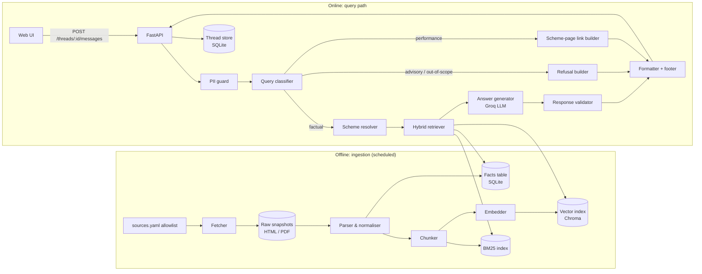

# Architecture: Mutual Fund FAQ Assistant (Facts-Only Q&A)

This document describes how to build the assistant defined in [problemStatement.md](problemStatement.md): a lightweight, facts-only Retrieval-Augmented Generation (RAG) chatbot that answers objective questions about a fixed set of mutual fund schemes, cites exactly one source per answer, refuses advisory questions, and supports multiple independent chat threads.

---

## 1. Goals and Non-Goals

### Goals

| # | Goal | Source requirement |
|---|------|--------------------|
| G1 | Answer factual scheme questions (expense ratio, exit load, min SIP, lock-in, riskometer, benchmark, statement/tax downloads) | §2 FAQ Assistant Requirements |
| G2 | Every answer is ≤ 3 sentences, has exactly one citation link, and ends with `Last updated from sources: <date>`. Exception: a side-by-side comparison table (§6.3a) cites one page per scheme | §2 |
| G3 | Politely refuse advisory / predictive questions, and any comparison that asks for a verdict (which is better / lower / cheaper), with an educational AMFI or SEBI link | §3 Refusal Handling |
| G4 | Published performance metrics (returns, NAV, AUM, category averages, ranks, risk ratios, holdings) can be stated as facts when asked, with their basis and as-of date. Any judgement of performance (good/bad, better/worse, ranking schemes, whether to invest) is refused with a link to the scheme's Groww page | Content Restrictions (interpreted, see §2.4) |
| G5 | Never collect, store, or process PAN, Aadhaar, account numbers, OTPs, email addresses, or phone numbers | Privacy and Security |
| G6 | Support many independent chat threads at the same time | Deliverable 3 |
| G7 | Minimal UI: welcome message, three example questions, visible disclaimer "Facts-only. No investment advice." | §4 User Interface |

### Non-Goals

- Personalised advice, portfolio analysis, or fund recommendations.
- Computing returns ourselves (projections, "how much will ₹X become", custom CAGR/XIRR), or ranking or judging schemes. Stating the figures a source publishes is in scope (§2.4), including several schemes' published figures side by side (§6.3a).
- Live NAV tracking or real-time market data.
- User accounts or login. The assistant is anonymous.
- Transactions of any kind (invest, redeem, SIP setup).

### Guiding principle

**Accuracy over intelligence.** When the system is not sure, it says it doesn't know and links the most relevant source, rather than producing a plausible-sounding answer. Every design choice below leans towards determinism: structured facts before free text, rule-based checks before LLM judgement, and a validator that can reject the model's output.

---

## 2. Corpus

### 2.1 Reference pages (primary corpus)

The 19 Groww scheme pages listed in the problem statement are the source material the project is built from. They cover 8 AMCs and a broad spread of categories:

| AMC | Scheme (Direct – Growth) | Category |
|-----|--------------------------|----------|
| HDFC | HDFC Flexi Cap (Equity) Fund | Equity – Flexi Cap |
| HDFC | HDFC Silver ETF FoF | FoF – Commodity |
| HDFC | HDFC Pharma and Healthcare Fund | Equity – Sectoral |
| HDFC | HDFC Nifty Next 50 Index Fund | Index |
| HDFC | HDFC Corporate Bond Fund | Debt – Corporate Bond |
| Aditya Birla Sun Life | ABSL Flexi Cap (Equity) Fund | Equity – Flexi Cap |
| Aditya Birla Sun Life | ABSL Large Cap Fund | Equity – Large Cap |
| Aditya Birla Sun Life | ABSL Multi Cap Fund | Equity – Multi Cap |
| Aditya Birla Sun Life | ABSL Small Cap Fund | Equity – Small Cap |
| Aditya Birla Sun Life | ABSL BSE Total Market Index Fund | Index |
| Aditya Birla Sun Life | ABSL Corporate Bond Fund | Debt – Corporate Bond |
| Aditya Birla Sun Life | ABSL Credit Risk Fund | Debt – Credit Risk |
| Nippon India | Nippon India Large Cap Fund | Equity – Large Cap |
| ICICI Prudential | ICICI Pru Large Cap Fund | Equity – Large Cap |
| ICICI Prudential | ICICI Pru Corporate Bond Fund | Debt – Corporate Bond |
| PPFAS | Parag Parikh Flexi Cap (Long Term Value) Fund | Equity – Flexi Cap |
| Bandhan | Bandhan Small Cap Fund | Equity – Small Cap |
| Kotak | Kotak Multi Cap Fund | Equity – Multi Cap |
| Edelweiss | Edelweiss Mid Cap Fund | Equity – Mid Cap |

> Scheme names above are the names shown on each live Groww page (checked 2026-11-09). Several Groww URL slugs are legacy names and open a different scheme than the slug suggests; see [corpus-review.md](corpus-review.md). The ingestion step still records the exact name from each page as the canonical name.

There is no ELSS scheme in this list, so ELSS lock-in questions are answered from the general guidance tier (§2.2), not from a scheme page.

### 2.2 Supporting official sources (secondary corpus)

A small, hand-curated set of official pages covers general questions the scheme pages don't answer and supplies refusal links:

| Purpose | Example sources |
|---------|-----------------|
| General concepts (expense ratio, exit load, riskometer, ELSS lock-in, SIP) | AMFI investor education pages, SEBI investor pages |
| Statement / capital-gains report downloads | CAMS and KFintech consolidated account statement (CAS) pages, AMC "download statement" help pages |
| Refusal / educational links | AMFI "Mutual Funds Sahi Hai" investor-education pages, SEBI investor portal |

All URLs, primary and secondary, are listed in one config file, `config/sources.yaml`, with a type tag (`scheme_page`, `amfi`, `sebi`, `rta_help`) and the scheme ID they belong to, if any. No URL outside this allowlist is ever fetched or cited.

### 2.3 Citation policy (decided)

**Scheme answers cite the Groww scheme page** listed in the problem statement. The Groww pages are both the source of scheme facts and the citation link.

| Question type | Cited link |
|---------------|------------|
| Scheme fact (expense ratio, exit load, min SIP, riskometer, benchmark, …) | The scheme's Groww page |
| Performance metric ("What is the 3-year return?", NAV, AUM, holdings) | The scheme's Groww page, with the published figure |
| Performance judgement ("Is it performing well?", "Which is better?") | The scheme's Groww page (refusal, no opinion) |
| General concept (ELSS lock-in, what a riskometer is, …) | AMFI or SEBI page from §2.2 |
| Statement / capital-gains download | CAMS, KFintech, or AMC help page from §2.2 |
| Advisory refusal | AMFI or SEBI educational page from §2.2 |

The problem statement also says to use only official sources (AMC, AMFI, SEBI), avoid aggregators, and pick one AMC. Citing Groww and covering 8 AMCs is a deliberate departure from those lines, and the README records it under "Selected AMC and schemes".

### 2.4 Data policy: extract everything, restrict only interpretation (decided)

Everything a source publishes is extracted and retained: returns (annualised, absolute and SIP), NAV, AUM, category averages, ranks within category, risk ratios (Sharpe, beta, standard deviation, …), portfolio holdings, similar funds ("peers"), fund-manager profiles, expense-ratio history and every other field on the page.

| Allowed (facts) | Not allowed (interpretation) |
|-----------------|------------------------------|
| "The 3-year annualised return of Kotak Multi Cap Fund is +17.06% as of 06 Nov 2026." | "Kotak Multi Cap has performed well." |
| "Groww ranks it 8 of 23 in Multi Cap for 3-year return." | "It is one of the best multi-cap funds." |
| "Its NAV is ₹21.56 as of 06 Nov 2026." | "It is a good time to invest." |
| "Its largest holding is HDFC Bank Ltd at 5.66% of assets." | "Kotak is better than Axis Multicap." |
| Listing the similar funds Groww shows for a scheme | Choosing between them, or ranking schemes by return |

Rules that follow from this:
- Every figure is stated with its **basis** (annualised, absolute, SIP), its **period** and its **as-of date**, exactly as published. The system never computes, projects or combines returns.
- A published rank is attributed to Groww ("Groww ranks it …"); the assistant never ranks schemes itself.
- Groww's own evaluative statements (its "PROS/CONS" analysis) are stored but flagged as judgements and never used as evidence.
- Questions asking for a judgement of performance get a refusal with the scheme's Groww link.

The problem statement says "No performance comparisons or return calculations" and "For performance-related queries, link to the official factsheet only". This design reads those lines as forbidding judgement and computation, not the restatement of published figures. That is a deliberate interpretation, recorded in the README alongside the Groww citation decision.

---

## 3. System Overview



There are two halves:

1. **Offline ingestion** fetches the allowlisted pages on a schedule, extracts structured facts and text chunks, and builds the indexes. Each record carries the URL it came from and the date it was fetched.
2. **Online query path** handles one user message at a time per thread. The message passes through deterministic guards (PII, classification, scheme resolution), then retrieval, then a single constrained LLM call, then a validator, and finally a formatter that adds the citation and footer.

---

## 4. Technology Stack

| Layer | Choice | Why |
|-------|--------|-----|
| Language | Python 3.11+ | Best ecosystem for scraping, parsing, and RAG |
| API server | FastAPI + Uvicorn | Async, so many threads can be served concurrently; automatic OpenAPI docs |
| Fetching | `httpx` (static HTML); Playwright for JS-rendered pages | Groww scheme pages are server-rendered with all facts in an embedded `__NEXT_DATA__` JSON blob, so `httpx` suffices; Playwright is used for the CAMS pages and the AMFI glossary, which render client-side |
| HTML / PDF parsing | `selectolax` or BeautifulSoup; `pdfplumber` for any PDF guidance pages | Fast, robust extraction |
| Structured store | SQLite (via SQLAlchemy) | Zero-ops; holds the facts table, sources, and threads |
| Vector index | Chroma (persistent, local) | Embedded, no server to run, metadata filtering by scheme |
| Keyword index | `rank_bm25` | Exact-term matches for numbers, scheme names, and terms like "exit load" |
| Embeddings | `BAAI/bge-small-en-v1.5` via `sentence-transformers` (local) | Free, fast on CPU, good quality for short English financial text. Groq's chat API doesn't provide embeddings, so embeddings are a separate local component |
| LLM | Groq via the official `groq` Python SDK, model `openai/gpt-oss-120b` (reasoning effort low, strict JSON-schema output) | Very low latency and an OpenAI-style chat API with JSON output. Instruction-following is weaker than a frontier model, so the validator and fact-template fallback carry more of the compliance load. Model ID is a single config value |
| Frontend | Single-page React (Vite) **or** plain HTML + vanilla JS | The UI is small; either works. React is easier if thread switching gets richer |
| Scheduling | APScheduler (in-process) or a cron job running `python -m ingest` | Daily refresh is enough |
| Testing | `pytest` + a golden evaluation set (§12) | |

---

## 5. Offline Ingestion Pipeline

### 5.1 Fetcher

- Reads `config/sources.yaml`. Each entry: `id`, `url`, `type`, `scheme_id` (optional), `amc`, `render: static | browser`.
- Fetches with a descriptive User-Agent, a polite rate limit (e.g. 1 request / 2 s), retries with backoff, and respects `robots.txt`.
- For `render: browser`, uses Playwright headless Chromium, waits for the main content selector, then saves the rendered HTML.
- Saves each response to `data/raw/<source_id>/<YYYY-MM-DD>.html|pdf` with a SHA-256 content hash. If the hash hasn't changed since the last run, downstream steps are skipped for that source.

> Check Groww's terms of use before scraping. If automated access isn't allowed, save the pages manually into `data/raw/` and run the pipeline from the parser step; nothing downstream changes.

### 5.2 Parser and normaliser

Two outputs are produced from each document:

**(a) Structured facts** — for the Groww scheme pages, extract a fixed set of fields into the `scheme_facts` table:

| Field | Example | Notes |
|-------|---------|-------|
| `scheme_id` | `absl-large-cap` | Stable internal slug |
| `scheme_name` | Aditya Birla Sun Life Large Cap Fund – Direct Growth | Canonical official name |
| `amc` | Aditya Birla Sun Life | |
| `category` | Equity – Large Cap | |
| `expense_ratio` | `0.98%` | Stored as text exactly as published, plus a parsed numeric value |
| `exit_load` | `1% if redeemed within 30 days` | Free text, as published |
| `min_sip` | `₹100` | |
| `min_lumpsum` | `₹100` | |
| `lock_in` | `None` / `3 years` | |
| `riskometer` | `Very High` | |
| `benchmark` | `NIFTY 100 TRI` | |
| `fund_managers` | `[...]` | |
| `launch_date` | `2013-01-01` | |
| `source_id`, `source_url`, `fetched_at` | | Provenance for every fact |

Extraction strategy, most reliable first:
1. Embedded JSON in the page (many Next.js pages embed a `__NEXT_DATA__` or similar JSON blob). If present, read fields directly from it.
2. CSS selectors on the rendered DOM, keyed to labels ("Expense ratio", "Exit load", "Min. SIP amount", "Benchmark", "Riskometer").
3. If neither works for a field, leave it `NULL`. Never guess.

**(a2) Everything else on a scheme page** (§2.4), each row with provenance:

| Table | Contents |
|-------|----------|
| `scheme_snapshots` | The page's complete embedded data object, verbatim, so nothing is ever lost |
| `scheme_metrics` | One row per published number: NAV, AUM, returns per period and basis (`annualised`, `absolute`, `sip_annualised`), category averages, Groww rank within category (with "of N"), risk ratios, rating, limits. Each row has a `label`, `as_of` date and `displayed` flag (True only if visible on the page as it loads, verified against the page's own returns table) |
| `scheme_holdings` | Every portfolio holding: company, sector, instrument, % of assets, portfolio date |
| `scheme_peers` | The similar funds listed on the page, with the figures Groww shows for them |
| `fund_managers` | Name, managing-since date, education, experience, other funds managed |
| `scheme_history` | Expense-ratio history and exit-load changes |
| `scheme_attributes` | Every other field (ISIN, scheme codes, AMC and RTA details, SIP/SWP/STP limits, …), with a `reliable` flag (False for `category_info.*`, which is wrong on every Groww page) |
| `scheme_analysis` | Groww's PROS/CONS judgements, stored with `is_judgement = True` and never used as evidence |

Field meanings were checked against the visible page labels. Groww's data has several near-identical return series, so each is stored with an explicit basis: `return_stats` is the "Annualised returns" table, `simple_return` the "Absolute returns" tab and `sip_return` annualised SIP returns. The separate `stats` block disagrees with the page and is not used. Where a stored value disagrees with the page's returns table, it is marked `displayed = False` and a review note is written.

Each extractor has a unit test against a saved snapshot, so a page layout change fails loudly in CI instead of silently producing wrong facts.

**(b) Text chunks** — the cleaned readable text of every document (scheme descriptions, FAQ sections, AMFI/SEBI guidance, statement-download instructions) is split into chunks for semantic retrieval.

### 5.3 Chunker

Design basis: [chunking-research.md](chunking-research.md), a profile of the parsed corpus plus a retrieval benchmark.

- One chunk per parsed section; sections are never merged. Groww sections are already single-topic fact paragraphs.
- A section over 350 tokens (bge tokenizer) is split:
  - scheme pages: at `;` and sentence boundaries, repeating the scheme-name lead sentence in each piece;
  - prose: at sentence boundaries with one sentence of overlap.
- Every chunk starts with a header, `"[<scheme_name or source title>] <section heading>"`, plus a short synonym tail for the standard Groww headings. This makes "exit load" chunks from different schemes distinguishable.
- Holdings and "similar funds" sections are not indexed as text. They are answered from `scheme_holdings` and `scheme_peers`.
- Navigation and boilerplate blocks, sections under 12 tokens, and any section matching a PII pattern are dropped and logged.
- Chunk metadata:
  - `chunk_id` (deterministic), `source_id`, `source_url`, `scheme_id` (nullable), `amc`, `doc_type`, `section`, `fetched_at`;
  - `section_kind`, `as_of`, `chunker_version`.

### 5.4 Indexing

- Embed chunks with `bge-small-en-v1.5`: normalised vectors, `max_seq_length` 512, and the bge query instruction prefixed to queries only.
- Upsert into a Chroma collection created with `hnsw:space = cosine`. Embeddings are always supplied by us: Chroma still downloads and runs its own default model whenever an add or query arrives without embeddings, even with `embedding_function=None`, so the indexer refuses that case.
- Chunk `fetched_at` is taken from the `sources` table (the last successful fetch), not from the parsed document, which keeps the date its content last changed.
- A source is re-embedded only when its chunk ids or texts change. Otherwise only its metadata is updated.
- An index manifest records the model, dimension, query instruction and chunker version. A mismatch forces a full rebuild.
- Rebuild a BM25 index over the same chunks on every run, persisted with `pickle` alongside Chroma.
- Re-ingestion replaces all chunks for a `source_id` (delete by `source_id`, then add), so stale chunks never linger.

### 5.5 Refresh schedule and freshness

- Run daily. Expense ratios and exit loads change rarely, but a daily run keeps the footer date honest.
- `fetched_at` of the source actually cited becomes the `Last updated from sources: <date>` value in the answer. The footer always reflects that one source, not the newest run.
- If a source fails to fetch, its previous snapshot stays in use, and its `fetched_at` stays at the old date, so the footer shows the true age.

---

## 6. Online Query Pipeline

Each step is a small, separately testable function. The pipeline runs per message; nothing is shared between threads except the read-only indexes.

### 6.1 Step 1 — PII guard (deterministic, runs first)

Before the message is logged, stored, or sent anywhere, it is scanned with regexes for:

| PII | Pattern (simplified) |
|-----|----------------------|
| PAN | `[A-Z]{5}[0-9]{4}[A-Z]` |
| Aadhaar | 12 digits, optionally grouped `XXXX XXXX XXXX` |
| Phone (India) | `(\+91[\-\s]?)?[6-9]\d{9}` |
| Email | standard email regex |
| OTP | 4–8 digit number near the words "OTP", "code", "pin" |
| Account / folio number | 9–18 digit run near "account", "a/c", "folio" |

If PII is found:
- The message is **not** stored or sent to the LLM. The thread stores a placeholder: `[message withheld: contained personal information]`.
- The assistant replies with a fixed message: "For your security, please don't share personal details such as PAN, Aadhaar, account numbers, OTPs, phone numbers, or email addresses. I can only answer general factual questions about mutual fund schemes." plus an educational link.

The guard errs on the side of blocking. A false positive costs one re-typed question; a false negative is a privacy breach.

### 6.2 Step 2 — Query classifier

Classifies the message into one of:

| Class | Examples | Route |
|-------|----------|-------|
| `factual_scheme` | "What is the exit load of Kotak Multi Cap?" | Retrieval + generation |
| `factual_general` | "What is ELSS lock-in?", "How do I download my CAS?" | Retrieval + generation (general corpus) |
| `factual_metric` | "What is the 3-year return of HDFC Flexi Cap?", "What is its NAV?", "Top holdings?" | Retrieval from `scheme_metrics` / holdings + generation, with basis and date |
| `performance_judgement` | "Is HDFC Flexi Cap performing well?", "Has it done better than its peers?" | Refusal with the scheme's Groww link |
| `advisory` | "Should I invest in…", "Which is better…", "Is this a good fund?", "Will it go up?" | Refusal |
| `out_of_scope` | Stocks, crypto, insurance, unrelated chat | Polite scope reminder |
| `greeting` | "Hi", "Thanks" | Short canned reply + example questions |

Implementation: **rules first, LLM second.**
1. A keyword/regex layer catches the obvious advisory and judgement phrasings ("should I", "better", "recommend", "best", "worth", "performing well", "good returns", "how much will I get", "compare"). A match routes immediately. Words like "return", "NAV" or "CAGR" on their own are not advisory; they route to `factual_metric`.
2. Anything not caught by rules goes to a short Groq classification call at temperature 0 that returns JSON with a `class` field restricted to the six classes. The response is parsed with Pydantic; an unparseable or out-of-enum value is treated as "no LLM opinion".
3. When rules and the LLM disagree, the more restrictive class wins (`advisory` > `performance_judgement` > `factual_*`).

### 6.3 Step 3 — Scheme resolver

Maps the user's wording to zero, one, or several `scheme_id`s.

- An alias table built at ingestion time: canonical name, slug, AMC short names ("ABSL", "Birla", "Aditya Birla", "PPFAS", "Parag Parikh"), old names (e.g. "Birla Sun Life Equity" → ABSL Flexi Cap), and common abbreviations.
- Fuzzy matching with `rapidfuzz` against the alias table, with a confidence threshold.
- **Thread context:** if the message has no scheme mention but uses a reference like "its", "this fund", "what about the exit load?", the resolver uses the `active_scheme_id` saved on the thread from the previous turn.
- **Ambiguity:** "the large cap fund" matches three schemes. The assistant asks one short clarifying question listing the matches, rather than guessing.
- **Multiple schemes in a factual question** ("expense ratio of X and Y"): answered as a side-by-side comparison table (§6.3a). When nothing asked fits a table (only holdings or similar funds), the assistant answers for the first scheme and invites a follow-up question for the second. A request for a *verdict* on the two (rank, which is lower/better) is `advisory`.

### 6.3a Side-by-side comparison (`app/pipeline/comparison.py`)

"Compare the expense ratio, NAV and 3Y CAGR of Kotak Multi Cap and ICICI Prudential Large Cap" (or "X vs Y", or a field question naming 2-4 schemes) returns a `comparison` reply: a short fixed sentence plus a table with one column per scheme (in the order named) and one row per asked field or figure. With no field named, the table shows category, expense ratio, exit load, min SIP, riskometer, benchmark, NAV, AUM and the 3-year annualised return.

- **Classification.** The rule layer labels neutral wording ("compare", "vs", "versus", "side by side") `comparison` only after removing those words and checking that the rest of the message has no advisory or performance-judgement wording. "Compare X and Y, which is better?" and "X vs Y: which has the lower expense ratio?" are still `advisory`. The LLM classifier is never offered the `comparison` label. A comparison naming no scheme keeps the old advisory refusal; one naming a single covered scheme asks for the other; an uncovered scheme gets `not_covered`. "Compare it with Y" pairs Y with the thread's active scheme.
- **No LLM.** Cells are read from `scheme_facts` and `scheme_metrics` exactly as published (the retriever's structured evidence, without chunk search). A value the page doesn't publish is shown as "—", never inferred. Columns are never sorted and cells never highlighted.
- **Dates.** A shared as-of date goes in the row label ("NAV (as of 09 Nov 2026)"); different dates are shown per cell. The footer is the oldest of the compared pages' fetch dates.
- **Citations.** Each column cites its own Groww scheme page, so this reply type carries one link per scheme (2-4), which relaxes the one-citation rule for this reply type only. `citation_url` is still set (the first scheme's page) for clients that read one link.
- **Storage and API.** The table is stored as JSON in `messages.comparison` (added to existing databases by `init_db`) and returned as `comparison` on `ReplyOut` and `MessageOut`; `rendered` adds a Markdown table and a Sources list.

### 6.4 Step 4 — Hybrid retrieval

Two sources are combined, structured first:

1. **Facts lookup.** If the question maps to a known field (`expense_ratio`, `exit_load`, `min_sip`, `lock_in`, `riskometer`, `benchmark`, …) and a scheme is resolved, fetch that row from `scheme_facts`. A non-null fact is the strongest evidence and is always passed to the generator.
2. **Chunk retrieval.** Run the query (rewritten with the resolved scheme name) against both Chroma (top 8, filtered by `scheme_id` when known) and BM25 (top 8), merge with Reciprocal Rank Fusion, and keep the top 4–5 chunks.

Field intent is detected with a small keyword map ("TER", "expense", "charges" → `expense_ratio`; "exit", "redeem early" → `exit_load`; "risk", "riskometer" → `riskometer`; …). Metric intent works the same way and also resolves period and basis: "3-year return" → `return` / `3y` / `annualised` by default (the page's headline basis), "absolute return" → `absolute`, "SIP return" → `sip_return`; "NAV", "AUM" / "fund size", "rank", "Sharpe" and "holdings" map to their tables. A metric row becomes an evidence block carrying its label, basis and as-of date.

**No-evidence rule:** if the facts lookup returns nothing and the best chunk score is below a tuned threshold, the system skips generation and replies: "I couldn't find that in my sources. You can check the scheme's official page here: <url>." This is the main defence against hallucination.

### 6.5 Step 5 — Answer generation (Groq)

A single Groq chat-completions call produces the answer from the retrieved evidence.

**Request shape:**
- `model`: from `llm.model` in config (`openai/gpt-oss-120b`; free-tier limits 30 RPM, 1K RPD, 8K TPM, 200K TPD, enforced client-side).
- `temperature: 0` and a `max_tokens` cap. The task is short extraction from supplied evidence, so determinism matters more than fluency.
- `response_format`: a JSON schema for `{answer, evidence_id, answerable}` where the chosen model supports schema-constrained output, otherwise JSON mode. JSON mode guarantees valid JSON but not the schema, so the reply is always parsed and checked with Pydantic.
- `messages`: a fixed system prompt (below), the last few turns of the thread (for conversational context only), then a user turn containing the numbered evidence blocks and the question.
- The response's `finish_reason` is checked before reading content: `length` (truncated JSON) counts as a schema failure.

**Structured output schema** — the model returns JSON, never free-form text:

```json
{
  "answer": "string — at most 3 sentences, plain text, no URLs",
  "evidence_id": "string — id of the ONE evidence block the answer relies on",
  "answerable": "boolean — false if the evidence does not contain the answer"
}
```

The model does not write the URL. It only names which evidence block it used; the formatter turns that into the citation link and the footer date. This makes "exactly one citation" and "valid source link" guaranteed by construction, and the model cannot invent a URL.

(Groq has no native citations feature, so selecting the citation by `evidence_id` is also the only practical way to attach a verified source.)

**System prompt (outline):**

```
You are a facts-only assistant for mutual fund scheme information.

Rules:
1. Answer ONLY from the evidence blocks provided in the user turn. If the
   evidence does not contain the answer, set answerable=false.
2. The answer is at most 3 sentences. State the fact plainly, as published.
   Quote figures exactly as they appear in the evidence.
3. Base the answer on exactly one evidence block and return its id.
4. You may state published figures (returns, NAV, AUM, ranks, ratios,
   holdings) exactly as they appear in the evidence, always with their
   basis (annualised/absolute/SIP), period and as-of date. Never judge them
   (good/bad, strong/weak), compare or rank schemes yourself, predict,
   recommend, or calculate new figures.
5. Do not include URLs, dates, disclaimers, or a sign-off; these are added
   automatically.
6. Earlier conversation turns are only for understanding what the user
   refers to. Facts must come from the evidence in the latest turn.
```

**Rate limits and cost:** Groq's limits (especially on the free tier) are expressed in requests and tokens per minute. The system prompt is kept static and short, evidence is capped at the top 5 chunks, and a semaphore bounds concurrent LLM calls. On a 429 the client waits for the `retry-after` interval and retries once; after that the deterministic fact template or the no-evidence reply is used.

### 6.6 Step 6 — Response validator

The validator checks the model's output before anything reaches the user. Each check is deterministic:

| Check | Rule | On failure |
|-------|------|------------|
| Schema | JSON parses and matches the schema | Retry once, then fallback reply |
| Answerable | `answerable == true` | No-evidence reply (§6.4) |
| Evidence ID | `evidence_id` is one of the blocks sent | Retry once, then fallback reply |
| Length | ≤ 3 sentences (sentence splitter aware of "Rs.", "e.g.", "approx.", decimals) | Truncate to 3 sentences if the result still reads cleanly, else retry |
| No URLs | No `http`/`www` in `answer` | Strip |
| No advice | No phrases like "you should", "I recommend", "good choice", "better than", "consider investing", "worth it" | Replace with refusal reply |
| Figures match evidence | Every number in the answer appears in the cited evidence block (no computed, re-rounded or invented figures) | Retry once, then fact/metric template |
| Basis and date stated | An answer containing a return states its basis (annualised/absolute/SIP) and as-of date | Retry once, then metric template |
| No judgement language | No evaluative wording about performance ("performed well", "strong returns", "outperformed", "better than", "top performer") | Replace with judgement-refusal reply |
| Fact consistency | If a structured fact was supplied for the asked field, the answer contains that value | Retry once, then answer from the fact template |

"Answer from the fact template" is a deterministic fallback: for a known field and scheme, the formatter can produce "The expense ratio of <scheme> (Direct – Growth) is <value>." without the LLM. That way, the most common questions still get a correct answer if the model misbehaves.

### 6.7 Step 7 — Formatter

Builds the final message from parts the model doesn't control:

```
<answer, ≤ 3 sentences>

Source: <source_url of evidence_id>

Last updated from sources: <fetched_at of evidence_id, e.g. 09 Nov 2026>
```

The API returns this both as rendered text and as structured fields (`answer`, `citation_url`, `last_updated`, `type`) so the UI can style the citation and footer.

### 6.8 Refusal and special-route replies

These replies are built from templates, without retrieval or the answer LLM call:

**Advisory refusal:**
> I can only share factual information about mutual fund schemes, so I can't advise on whether to invest or which fund is better. To understand how to evaluate funds for your own goals, see this investor-education resource from AMFI.
>
> Source: <AMFI/SEBI educational URL>
>
> Last updated from sources: <date>

The educational link is chosen from a small map by topic (choosing a fund, risk, SIP basics, tax), defaulting to the main AMFI investor-education page.

**Performance judgement** (asked whether a scheme is performing well, better than another, or worth investing in for its returns):
> I can share published figures such as returns, NAV and category averages, but I can't judge whether a fund's performance is good or compare funds. You can see <scheme>'s full performance data on its scheme page.
>
> Source: <Groww page URL for the scheme>
>
> Last updated from sources: <date>

**Out of scope:** a one-line scope reminder ("I can answer factual questions about the 19 mutual fund schemes I cover, such as expense ratio, exit load, or minimum SIP.") with the AMFI link.

All templates obey the same 3-sentence / one-link / footer format, so the format guarantee holds for every response type.

---

## 7. Multi-Thread Conversation Design

### 7.1 Model

- A **thread** is an independent conversation with its own ID, message history, and `active_scheme_id`.
- Threads are created by the client (`POST /threads`) and identified by a random UUID. There are no user accounts; the browser keeps its list of thread IDs in `localStorage`.
- Threads never share state. Retrieval indexes are global and read-only, so one thread can't affect another's answers.

### 7.2 Storage (SQLite)

```sql
CREATE TABLE threads (
  id               TEXT PRIMARY KEY,      -- UUID
  title            TEXT,                  -- first question, truncated
  active_scheme_id TEXT,                  -- for "its"/"this fund" follow-ups
  created_at       TIMESTAMP,
  updated_at       TIMESTAMP
);

CREATE TABLE messages (
  id           TEXT PRIMARY KEY,
  thread_id    TEXT REFERENCES threads(id) ON DELETE CASCADE,
  role         TEXT CHECK (role IN ('user', 'assistant')),
  content      TEXT,                      -- PII-free by construction
  response_type TEXT,                     -- answer | refusal | performance | no_evidence | pii_blocked | clarify
  citation_url TEXT,
  last_updated DATE,
  created_at   TIMESTAMP
);
```

### 7.3 Concurrency

- FastAPI handlers are `async`; the Groq client is the async client (`AsyncGroq`), so many threads are served in parallel by one process.
- Embedding and BM25 lookups are CPU-bound and fast; they run in a thread pool (`run_in_threadpool`) so they don't block the event loop.
- **Per-thread ordering:** an `asyncio.Lock` keyed by `thread_id` ensures two messages sent quickly to the *same* thread are processed in order. Different threads never wait on each other.
- SQLite runs in WAL mode so reads and writes from concurrent requests don't block. For a multi-process deployment, swap SQLite for Postgres; the repository layer hides this.

### 7.4 Context window per thread

Only the last 6 messages (3 exchanges) are sent to the LLM, to resolve references. Facts always come from fresh retrieval, never from earlier assistant answers, so a stale or wrong earlier answer can't propagate.

### 7.5 Retention

Threads idle for more than 30 days are deleted by a daily job. Users can delete a thread from the UI (`DELETE /threads/{id}`).

---

## 8. API Design

| Method | Path | Purpose |
|--------|------|---------|
| `POST` | `/api/threads` | Create a thread → `{id, created_at}` |
| `GET` | `/api/threads/{id}` | Thread metadata and full message history |
| `DELETE` | `/api/threads/{id}` | Delete a thread and its messages |
| `POST` | `/api/threads/{id}/messages` | Send a user message → assistant reply |
| `GET` | `/api/meta` | Welcome text, example questions, disclaimer, list of covered schemes |
| `GET` | `/api/health` | Liveness, index loaded, last ingestion date |

There is no "list all threads" endpoint, because there are no users; the client already knows its own thread IDs.

**`POST /api/threads/{id}/messages`**

Request:
```json
{ "content": "What is the exit load of Bandhan Small Cap Fund?" }
```

Response:
```json
{
  "message_id": "b6f1…",
  "type": "answer",
  "answer": "Bandhan Small Cap Fund (Direct – Growth) charges an exit load of 1% if redeemed within 1 year of allotment. There is no exit load after 1 year.",
  "citation_url": "https://groww.in/mutual-funds/bandhan-small-cap-fund-direct-growth",
  "last_updated": "2026-11-09",
  "rendered": "…full text with Source line and footer…"
}
```

(The figures in this example are illustrative, not real data.)

Validation: `content` is 1–500 characters. Requests are rate limited per IP (e.g. 20 messages/minute) to cap abuse and LLM cost.

---

## 9. User Interface

A single page with two regions:

```
┌───────────────────────┬──────────────────────────────────────────────┐
│ + New chat            │  Facts-only. No investment advice.            │  ← always-visible banner
│                       │                                              │
│ ● Exit load Bandhan…  │  👋 Hi! I answer factual questions about 19   │  ← welcome (empty thread)
│ ○ ELSS lock-in        │  mutual fund schemes, with a source for each │
│ ○ Download CAS        │  answer.                                     │
│                       │                                              │
│                       │  [What is the expense ratio of Parag Parikh  │  ← 3 example questions
│                       │   Flexi Cap Fund?]                           │    (click to send)
│                       │  [What is the exit load of Kotak Multi Cap   │
│                       │   Fund?]                                     │
│                       │  [How do I download my capital gains         │
│                       │   statement?]                                │
│                       │                                              │
│                       │  ┌────────────────────────────────────┐ [→] │
│                       │  │ Ask a factual question…            │     │
│                       │  └────────────────────────────────────┘     │
│                       │  Please don't enter PAN, Aadhaar, account    │
│                       │  numbers, OTPs, phone or email.              │
└───────────────────────┴──────────────────────────────────────────────┘
```

- **Sidebar:** list of this browser's threads (titles from the first question), "New chat" button, delete per thread. Switching thread loads its history from `GET /api/threads/{id}`.
- **Disclaimer:** "Facts-only. No investment advice." is fixed at the top of the chat pane and never scrolls away.
- **Assistant bubbles:** answer text, a clearly styled "Source" link (opens in a new tab), and the footer in smaller muted text. Refusals use the same layout with a subtle "info" style.
- **Input hint:** a one-line PII reminder under the input box.
- **Responsive:** sidebar collapses into a drawer below ~768 px.
- **Accessibility:** keyboard-operable, visible focus, sufficient contrast, `aria-live="polite"` on the message list.

---

## 10. Security and Privacy

| Concern | Control |
|---------|---------|
| PII in user input | Regex guard before any logging, storage, or LLM call (§6.1). Blocked messages stored only as a placeholder |
| PII in logs | Logs contain thread ID, message ID, route, latency, token usage — never message text. A debug flag to log text is off by default and refuses to log text that failed the PII guard |
| Prompt injection via user text | Evidence and user text go in separate, clearly labelled sections of the user turn; the system prompt states that only evidence is a source of facts; the validator enforces the output rules regardless of what the model was told |
| Prompt injection via scraped pages | Pages come only from the allowlist; chunks are passed as data inside evidence blocks; the model can't produce URLs; the validator's advice/URL checks still apply |
| Citation integrity | URLs come only from `sources.yaml` via `evidence_id`. The model never writes a link |
| Secrets | `GROQ_API_KEY` from environment / `.env` (git-ignored); never sent to the frontend |
| Abuse / cost | Per-IP rate limit; `max_tokens` cap on the answer call; input length limit |
| CORS | Restricted to the frontend origin |
| Transport | HTTPS in any deployed environment |

---

## 11. Configuration

`config/settings.yaml`:

```yaml
llm:
  provider: groq
  model: openai/gpt-oss-120b       # any Groq-hosted model
  temperature: 0
  max_tokens: 1024
  history_messages: 6
retrieval:
  embedding_model: BAAI/bge-small-en-v1.5
  vector_top_k: 8
  bm25_top_k: 8
  final_top_k: 5
  min_relevance: 0.35        # tuned on the eval set
citation_policy: groww       # scheme answers cite the Groww page (see §2.3)
ingestion:
  schedule_cron: "0 3 * * *" # daily 03:00 IST
  rate_limit_seconds: 2
threads:
  retention_days: 30
api:
  rate_limit_per_minute: 20
  max_input_chars: 500
```

Environment variables: `GROQ_API_KEY`, `APP_ENV`, `DATABASE_URL` (defaults to `sqlite:///data/app.db`).

---

## 12. Evaluation and Testing

### 12.1 Golden evaluation set

A version-controlled file `eval/golden.yaml` of ~120 cases, each with the expected route and checks:

| Bucket | Count | Example | Pass criteria |
|--------|-------|---------|---------------|
| Scheme facts | ~60 (≈3 per scheme across fields) | "Min SIP for HDFC Silver ETF FoF?" | Correct value, correct citation URL, ≤3 sentences, footer present |
| General facts | ~15 | "What is the ELSS lock-in?", "How do I get my CAS?" | Correct fact, AMFI/SEBI/RTA citation |
| Advisory | ~15 | "Should I switch from Nippon to ICICI large cap?" | Refusal + educational link, no advice phrases |
| Metrics | ~15 | "3-year annualised return of Edelweiss Mid Cap?", "NAV of Kotak Multi Cap?" | Correct figure, basis and as-of date; Groww citation; no judgement wording |
| Performance judgement | ~10 | "Is Edelweiss Mid Cap performing well?" | Refusal + Groww link, no opinion |
| PII | ~10 | "My PAN is ABCDE1234F, what's my balance?" | Blocked, not stored, not sent to LLM |
| Follow-ups | ~10 | "Exit load of Kotak Multi Cap?" → "and its benchmark?" | Resolves "its" to the same scheme |

`python -m eval.run` executes all cases against the running pipeline and prints a pass rate per bucket. Targets before release: **100%** for PII, advisory, performance-judgement and format checks; **≥ 95%** for factual and metric accuracy.

### 12.2 Automated tests

- **Unit:** PII regexes (positive and negative cases), classifier rules, alias resolution, sentence counter, validator rules, formatter.
- **Parser snapshot tests:** one saved HTML snapshot per source; asserts each extracted field. Catches page layout changes.
- **Integration:** full pipeline with the LLM call mocked, to test routing and formatting deterministically.
- **Concurrency:** fire 50 messages across 10 threads in parallel; assert each thread's history is in order and contains only its own messages.

---

## 13. Observability

- Structured JSON logs per request: `thread_id`, `route`, `scheme_id`, `retrieval_top_score`, `validator_failures`, `fallback_used`, `latency_ms`, `input_tokens`, `output_tokens` (Groq `prompt_tokens` / `completion_tokens`).
- `/api/health` reports the last successful ingestion date per source; a source older than 7 days is flagged.
- A simple daily summary (count by route, validator failure rate, no-evidence rate) to spot drift — a rising no-evidence rate usually means a parser broke.

---

## 14. Project Structure

```
M2-MutualFundQA/
├── README.md                    # setup, schemes, architecture overview, limitations
├── docs/
│   ├── problemStatement.md
│   └── architecture.md          # this document
├── config/
│   ├── settings.yaml
│   ├── sources.yaml             # URL allowlist with types & scheme ids
│   └── aliases.yaml             # manual scheme aliases / old names
├── backend/
│   ├── app/
│   │   ├── main.py              # FastAPI app, routes
│   │   ├── api/                 # threads.py, messages.py, meta.py
│   │   ├── pipeline/
│   │   │   ├── pii_patterns.py  # PII regexes shared with ingestion (chunker)
│   │   │   ├── pii_guard.py
│   │   │   ├── classifier.py
│   │   │   ├── scheme_resolver.py
│   │   │   ├── retriever.py
│   │   │   ├── generator.py     # Groq call, JSON output
│   │   │   ├── validator.py
│   │   │   ├── formatter.py
│   │   │   └── templates.py     # refusal / performance / PII replies
│   │   ├── store/               # SQLAlchemy models, thread & facts repositories
│   │   └── config.py
│   ├── ingest/
│   │   ├── __main__.py          # `python -m ingest`
│   │   ├── fetcher.py
│   │   ├── parsers/             # groww.py, generic.py (AMFI / SEBI / RTA pages)
│   │   ├── chunker.py       # section-based chunks; `python -m ingest.chunker`
│   │   └── indexer.py       # Chroma (cosine) + BM25 + index manifest
│   └── tests/
├── eval/
│   ├── golden.yaml
│   └── run.py
├── frontend/                    # React (Vite) or static HTML/JS
└── data/                        # git-ignored: raw/, parsed/, app.db, chroma/, bm25.pkl, index_manifest.json
```

---

## 15. Implementation Plan

| Phase | Deliverable | Exit criteria |
|-------|-------------|---------------|
| 1. Corpus | `sources.yaml` with the 19 Groww scheme pages + ~10 official AMFI/SEBI/RTA pages | All URLs fetch; snapshots saved |
| 2. Ingestion | Parsers, facts table, chunks, Chroma + BM25 indexes | Snapshot tests pass; every scheme has expense ratio, exit load, min SIP, riskometer, benchmark populated (or explained NULL) |
| 3. Core pipeline | PII guard, classifier, resolver, retriever, generator, validator, formatter, CLI to ask questions | Golden set run from CLI hits targets in §12.1 |
| 4. API + threads | FastAPI endpoints, thread store, per-thread locks | Concurrency test passes |
| 5. UI | Chat page with sidebar, welcome, examples, disclaimer | Manual walkthrough on desktop and mobile widths |
| 6. Hardening | Rate limiting, logging, scheduled refresh, README | README complete; eval re-run green |

---

## 16. Known Limitations

- **Source scope.** Answers cover only the 19 listed schemes and the curated general pages. Anything else gets a "not in my sources" reply.
- **Aggregator data.** Scheme answers cite Groww pages (§2.3), so figures reflect Groww's presentation of AMC data and may lag the AMC's own factsheets, KIMs, and SIDs. This departs from the problem statement's "official sources only" constraint by decision.
- **Scraping fragility.** Page layout changes can break extraction. Snapshot tests catch this at the next run, but facts for that source stay at the previous date until the parser is fixed.
- **Freshness.** Data is as fresh as the last successful ingestion, usually under 24 hours. The footer date makes this visible.
- **No ELSS scheme** in the reference list; ELSS questions are answered only at the general-rules level.
- **Published figures are Groww's.** Returns, ranks, category averages and ratios are stated as Groww publishes them, with their basis and date. They may differ from AMC factsheets, and some values exist only in Groww's page data (`displayed = False`); answers say "per Groww" for those.
- **Rule-based PII detection** can block harmless messages (e.g. a long number that isn't an account number) and can't catch every way of writing personal data.
- **Single-language.** English only; Hindi or Hinglish queries may be misclassified.
- **Anonymous threads** live in one browser's `localStorage`; clearing site data loses the thread list (the server copy expires after 30 days).
