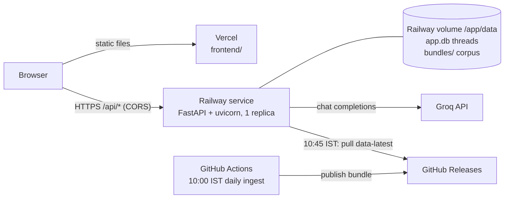

# Deployment Plan: Railway (backend) + Vercel (frontend)

This plan puts the Mutual Fund FAQ Assistant online with:
- the FastAPI backend on **Railway**;
- the static chat UI on **Vercel**;
- the corpus refreshed daily by the existing GitHub Actions workflow ([implementation-plan.md, Phase 11](implementation-plan.md#phase-11--scheduled-data-refresh-github-actions)).

It lists the code changes needed first, the setup steps for each platform, the checks to run after going live, and how to operate and roll back.

Status: **§4.1–§4.6 code changes made** (tests in `backend/tests/test_deploy.py`). Still to do before the first deploy: fill in the two `TODO` values in `config/settings.production.yaml` (`api.cors_origins`, `data_refresh.release_repo`), and run the `docker build` / empty-volume `docker run` check in §4's definition of done.

---

## 1. Target architecture



| Piece | Where | Notes |
|---|---|---|
| Chat UI (`frontend/index.html`, `app.js`, `styles.css`) | Vercel, static, no framework | Calls the Railway API directly |
| API (`backend/app`) | Railway, one service built from a Dockerfile | Embedding model baked into the image |
| Threads database (`data/app.db`) | Railway volume | Never leaves the server |
| Corpus (Chroma, BM25, `corpus.db`) | Railway volume, `data/bundles/<id>/` | Pulled from GitHub Releases, never built on Railway |
| Daily ingestion | GitHub Actions (already built) | Railway never scrapes |

---

## 2. Decisions

**D1. The browser calls Railway directly, not through a Vercel rewrite.**
- A Vercel rewrite (`/api/*` → Railway) would avoid CORS. But Railway's edge would then see Vercel's IP address, not the user's.
- Railway's edge overwrites `X-Real-IP` and `X-Forwarded-For` with the IP of whoever connects to it. With a rewrite in between, every user would share a handful of Vercel IPs, and the per-IP rate limit (20 messages/min) would become one global limit.
- Calling Railway directly keeps each user's own IP. The cost is a CORS allowlist and a configurable API base URL in the frontend (§4.1, §4.3).

**D2. One Railway service, one replica, one uvicorn worker, with a volume.**
- The app keeps in-memory, per-process state: the per-IP rate limiter, per-thread locks, the Groq rate limiter and the daily counters.
- It uses SQLite, and a Railway service with a volume can't have replicas.
- Redeploys therefore have a few seconds of downtime: Railway stops the old deployment before starting the new one when a volume is attached. That is acceptable for this project.

**D3. The corpus arrives as a bundle; Railway never runs ingestion.**
- The Phase 11 workflow already builds, checks and publishes the corpus daily.
- The server pulls the `data-latest` release at startup and at 10:45 IST, and hot-reloads it (`BundlePuller`, `app/jobs.py`).
- So the image needs no Chromium, and scraping traffic never comes from Railway.

**D4. Docker build, not Railway's auto-detected builder.**
- The image needs CPU-only PyTorch (the default wheel adds gigabytes of CUDA libraries).
- It also needs the embedding model downloaded at build time, and an editable install: `app/config.py` finds the project root from the source layout, so `pip install .` into site-packages would point `ROOT_DIR` at the wrong folder.
- A Dockerfile makes all of this explicit.

**D5. Production settings live in a committed `config/settings.production.yaml`, chosen by `APP_SETTINGS_FILE`.**
- Today `load_settings()` passes the YAML values as constructor arguments, which take priority over environment variables. Nested settings such as `api.cors_origins` therefore can't be overridden from Railway variables.
- A separate production YAML file (no secrets in it) is explicit and reviewable.
- Secrets stay in Railway variables: `GROQ_API_KEY`, `DATA_REFRESH_TOKEN`.

---

## 3. Prerequisites

- [ ] **GitHub repository.** Push this project to GitHub (there is no remote yet). Railway and Vercel both deploy from it, and the data bundles are its releases.
- [ ] **First data bundle published.** Run **Actions → Daily data refresh → Run workflow** once and confirm the `data-latest` release has `data-bundle.tar.gz`, `data-bundle.tar.gz.sha256` and `bundle.json`. The server can't answer without it.
- [ ] **Groq API key** for the production account. The free tier allows about 6 answers per minute for the whole server (8K tokens/min). See §8.4.
- [ ] **Private repository only:** a fine-grained GitHub token with read-only *Contents* access to this repository, for `DATA_REFRESH_TOKEN`.
- [ ] Railway and Vercel accounts connected to the GitHub repository.

---

## 4. Code changes before the first deploy

Each change needs tests and must keep local development working unchanged.

### 4.1 Configurable API base URL in the frontend
- Add `frontend/config.js` with `window.MF_API_BASE = "/api";` (the same-origin default, so local `uvicorn` keeps working).
- Load it before `app.js` in `index.html`.
- In `app.js`, change `const API = "/api";` to `const API = window.MF_API_BASE || "/api";`.
- On Vercel, the build step overwrites `config.js` with the Railway URL (§6).

### 4.2 Production settings file
- `load_settings()` reads the file named by the `APP_SETTINGS_FILE` environment variable, defaulting to `config/settings.yaml`.
- Add `config/settings.production.yaml`: a full copy of `settings.yaml` with the production values in §7.2. Keep a test that the two files have the same keys, so they can't drift.

### 4.3 Real client IP behind Railway
- Add `api.client_ip_header` (default empty). When it is set, the rate limiter keys on that header (`x-real-ip` on Railway) instead of the socket address.
- Keep `trust_forwarded_for: false` in production.
- Test that a client-supplied header is used only when configured.
- This relies on Railway's edge overwriting `X-Real-IP`. That is stated in recent Railway staff answers, not in a versioned contract, so check it after deploying (§9, item 7).

### 4.4 Boot with an empty volume
On a fresh volume, startup currently fails (`no such table: sources`) because `build_services` loads the corpus before the bundle puller ever runs. Two changes:
- **`python -m app.bootstrap`**, run before uvicorn:
  - if the active corpus has no `index_manifest.json` and `data_refresh.release_repo` is set, download, verify and install `data-latest` (reusing `BundlePuller`'s download and `ingest.bundle.install`), then point `CURRENT` at it;
  - it exits 0 in every case (with a log line), so a GitHub outage can't stop the API from starting.
- **`build_services` tolerates a missing corpus:**
  - it starts in degraded mode, where `/api/health` reports `index_loaded: false` and replies are the honest "unavailable" template;
  - it doesn't crash;
  - the reload check then picks the corpus up once a bundle lands.

### 4.5 Dockerfile, `.dockerignore`, `railway.json` (repository root)

```dockerfile
FROM python:3.12-slim
ENV PYTHONUNBUFFERED=1 PYTHONUTF8=1 PIP_NO_CACHE_DIR=1 HF_HOME=/opt/hf
WORKDIR /app
COPY pyproject.toml ./
COPY backend ./backend
COPY config ./config
COPY frontend ./frontend
# CPU-only torch first, then the project as an editable install (ROOT_DIR = /app).
RUN pip install torch --index-url https://download.pytorch.org/whl/cpu \
 && pip install -e .
# Bake the embedding model into the image: no download at startup, no Hugging Face dependency.
RUN python -c "from sentence_transformers import SentenceTransformer as S; S('BAAI/bge-small-en-v1.5')"
ENV HF_HUB_OFFLINE=1 TRANSFORMERS_OFFLINE=1
WORKDIR /app/backend
CMD ["sh", "-c", "python -m app.bootstrap && exec uvicorn app.main:app --host 0.0.0.0 --port ${PORT:-8000} --workers 1"]
```

`.dockerignore`: `.git`, `.venv`, `data/`, `eval/results/`, `stitch_groww_mutual_fund_ai_assistant/`, `**/__pycache__`, `.env`, `dist/`, `prev/`, `work/`.

`railway.json` (check the keys against Railway's config-as-code reference when adding it):

```json
{
  "$schema": "https://railway.com/railway.schema.json",
  "build": { "builder": "DOCKERFILE", "dockerfilePath": "Dockerfile" },
  "deploy": {
    "healthcheckPath": "/api/health",
    "healthcheckTimeout": 300,
    "restartPolicyType": "ON_FAILURE",
    "numReplicas": 1
  }
}
```

`/api/health` returns 200 even when degraded, so a missing bundle doesn't fail the deploy. Railway runs the health check only at deploy time, not continuously.

### 4.6 Optional: Vercel preview deployments
Preview URLs (`<project>-<hash>-<team>.vercel.app`) aren't in the CORS allowlist, so previews can show the UI but not answer. If previews should work:
- add `api.cors_origin_regex`, passed to `CORSMiddleware(allow_origin_regex=...)`;
- match only this project's preview pattern.

Otherwise leave previews non-functional.

### Definition of done for §4
- All tests pass, and the `--no-llm` eval still meets every gate.
- `docker build` succeeds.
- `docker run -p 8000:8000 -e PORT=8000 -e APP_SETTINGS_FILE=../config/settings.production.yaml` with an **empty** `/app/data` volume:
  - boots;
  - pulls `data-latest`;
  - answers "What is the exit load of Kotak Multi Cap Fund?" with a source link and the footer.

---

## 5. Railway setup (backend)

1. **New project → Deploy from GitHub repo**, and pick this repository. Railway finds `railway.json` and the Dockerfile.
2. **Volume:** add one volume to the service, mounted at **`/app/data`**.
   - It holds `app.db` (threads) and `bundles/` (the corpus). Expect under 200 MB: a bundle unpacks to about 30 MB, two are kept, and `app.db` grows with threads until the 30-day retention.
   - If the image ever runs as a non-root user, check Railway's note on volume permissions (`RAILWAY_RUN_UID`).
3. **Variables** (§7.1): `GROQ_API_KEY`, `APP_SETTINGS_FILE`, `APP_ENV`, and `DATA_REFRESH_TOKEN` (private repository only).
4. **Resources:** at least **1 GB RAM**; 2 GB leaves headroom.
   - The loaded server measured about 610 MB working set locally: PyTorch, bge-small, Chroma, BM25 and the catalog.
   - CPU usage is light: one embedding per question.
5. **Networking:** generate the Railway domain (`<service>.up.railway.app`), or attach a custom domain such as `api.example.com`. Note the URL for Vercel (§6) and CORS (§7.2).
6. **Region:** pick one close to the users. India-based users and Groq's API are the main latency factors.
7. Deploy. The first boot takes about 20–60 s: the bundle download plus about 19 s to load the pipeline.

---

## 6. Vercel setup (frontend)

1. **New project → Import** this repository.
2. **Root Directory:** `frontend`.
   - Framework preset, build command, output directory and install command come from the committed `frontend/vercel.json`. Its build step writes `config.js` from `API_BASE_URL`, and fails if the variable is missing.
3. **Environment variable:** `API_BASE_URL` = `https://<railway-domain>/api`, for Production (and Preview, if §4.6 is done). It isn't secret: the browser sees it.
4. `frontend/vercel.json` also sets these headers:
   - `X-Content-Type-Options: nosniff`;
   - `Referrer-Policy: strict-origin-when-cross-origin`;
   - a short cache for `config.js`, so a changed API URL takes effect quickly.
5. Deploy, and note the production URL (`<project>.vercel.app` or a custom domain) for CORS (§7.2).

Order matters: deploy Railway first (Vercel needs its URL), then Vercel, then put Vercel's final URL into `api.cors_origins` and redeploy Railway.

---

## 7. Configuration

### 7.1 Railway variables

| Variable | Value | Secret |
|---|---|---|
| `GROQ_API_KEY` | production Groq key | yes |
| `APP_SETTINGS_FILE` | `../config/settings.production.yaml` (relative to `/app/backend`; or absolute `/app/config/settings.production.yaml`) | no |
| `APP_ENV` | `production` | no |
| `DATA_REFRESH_TOKEN` | read-only GitHub token (private repository only) | yes |
| `PORT` | set by Railway, don't set it | — |

`DATABASE_URL` and `CORPUS_DATABASE_URL` stay at their defaults (`data/app.db`, `data/corpus.db`), which resolve under the volume at `/app/data`.

### 7.2 `config/settings.production.yaml`: differences from `settings.yaml`

| Setting | Production value | Why |
|---|---|---|
| `api.cors_origins` | `["https://<project>.vercel.app"]` plus any custom frontend domain | Only the real frontend may call the API |
| `api.client_ip_header` | `x-real-ip` | Per-user rate limits behind Railway's edge (§4.3) |
| `api.trust_forwarded_for` | `false` | Not needed, given `client_ip_header` |
| `data_refresh.release_repo` | `<owner>/<repo>` | Turns on the daily bundle pull and the startup bootstrap |
| `ops.log_format` | `json` | Railway shows one JSON object per line |
| `ops.reload_check_seconds` | `60` | Picks up a manually installed bundle |

Everything else (models, limits, retention, schedules) stays as in `settings.yaml`.

### 7.3 Vercel variables

| Variable | Value |
|---|---|
| `API_BASE_URL` | `https://<railway-domain>/api` |

---

## 8. Operations

### 8.1 Daily data flow (IST)

| Time | What happens |
|---|---|
| 10:00 (+ GitHub delay) | Actions runs: restore → ingest → quality gate → tests → eval → publish `data-YYYY-MM-DD` and `data-latest` |
| about 10:20 | Release assets updated (archive first, `bundle.json` last) |
| 10:45 | Railway server pulls `data-latest`, verifies it, installs it to `bundles/<id>/`, checks it, switches `CURRENT` and hot-reloads. Footers show the new date. |

A failed workflow publishes nothing; the server keeps serving yesterday's bundle. `/api/health` reports `bundle_stale: true` (status `degraded`) once the bundle is more than 2 days old.

### 8.2 Monitoring
- **Railway logs** (JSON lines, never message text):
  - `turn`: one per message, with route, latency and tokens;
  - `bundle installed` / `bundle pull failed`;
  - `corpus reloaded`;
  - `retention`;
  - `daily summary`: counts by route, validator failure rate and no-evidence rate;
  - `rate limited`.
- **GitHub Actions:** a failed daily run emails the repository owner.
- **External uptime check** (recommended; Railway checks health only at deploy time): poll `GET /api/health` every 5 minutes and alert on non-200 or `status != "ok"`. Any free uptime monitor will do.

### 8.3 Rollback

| Problem | Action |
|---|---|
| Bad backend release | Railway → Deployments → redeploy the previous deployment. The volume (threads, bundles) is untouched. |
| Bad frontend release | Vercel → Deployments → promote the previous deployment (instant). |
| Bad data bundle that passed the gate | In a Railway shell, run `ls /app/data/bundles`, then `echo <previous-bundle> > /app/data/bundles/CURRENT`. The reload check switches within 60 s after checking it. Then fix and re-run the workflow. |
| Groq outage or quota exhausted | Nothing to do: replies fall back to deterministic fact templates or the "try again in a minute" reply. Health still reports `ok` (the LLM is configured). |

### 8.4 Capacity and cost
- **Groq free tier:** about 6 generated answers per minute and 200K tokens per day for the whole server; a typical answer uses 1.0–1.3K tokens. Beyond that, requests wait up to 30 s and then fall back to templates.
- **For more traffic:** a paid Groq tier and raising `llm.*` limits in the production settings. Railway scaling doesn't help, because one replica is a hard limit with a volume.
- **Railway:** one always-on service with about 1 GB RAM plus a small volume.
- **Vercel:** static hosting; the Hobby tier is enough for a demo.
- **GitHub:** Actions minutes for one run of about 10–15 minutes a day, and release storage of about 5 MB × 15 releases.

### 8.5 Data and privacy
- Threads stay on the Railway volume only. They are deleted after 30 days idle (`threads.retention_days`) and are never in a bundle.
- Logs never contain message text, and `GROQ_API_KEY` never appears in responses or logs (both tested in Phase 10).
- Volume backups are optional: threads are disposable and the corpus can be re-pulled. If thread history matters, schedule backups of `/app/data/app.db`.

---

## 9. Go-live verification

Run these against the production URLs after §5–§7.

1. `GET https://<railway>/api/health` returns `status: ok`, `index_loaded: true`, `llm_configured: true`, `corpus: "bundle <id>"`, `bundle_stale: false` and `stale_sources: []`.
2. Open the Vercel URL. The welcome message, the three example questions, the disclaimer "Facts-only. No investment advice." and the 19 schemes in the side panel all load. The browser console shows no CORS errors.
3. Clicking "What is the exit load of Kotak Multi Cap Fund?" gives an answer of at most 3 sentences, one Groww source link, and a `Last updated from sources` footer with today's or yesterday's date.
4. A follow-up ("What is its expense ratio?") resolves to the same scheme. A second chat thread keeps its history separate.
5. "Should I invest in Parag Parikh Flexi Cap?" gets a refusal with an AMFI/SEBI link. "My PAN is ABCDE1234F" gets the privacy reply, and the thread shows only the placeholder.
6. Logs show `turn` records with no message text, plus `bundle up to date` or `bundle installed`.
7. **Rate limit per user:**
   - from one network, send 21 messages within a minute: the 21st gets 429 with `Retry-After` and the UI shows the wait message;
   - at the same time, a second network (for example a phone on mobile data) can still send. This confirms `X-Real-IP` carries the real client IP.
   - If both networks are limited together, the header isn't per-client: switch `client_ip_header` off and investigate before launch.
8. **Volume persistence:** redeploy the Railway service; existing threads are still there afterwards, and the bundle isn't downloaded again.
9. **CORS lock:** a request from another origin (for example `curl -H "Origin: https://evil.example" -i <railway>/api/meta`) returns no `access-control-allow-origin` header.
10. The next day after 10:45 IST, the footer dates and `/api/health`'s `corpus` show the new bundle with no manual step.

---

## 10. Rollout order

| Step | Task | Done when |
|---|---|---|
| 1 | Push to GitHub, run the daily workflow by hand | `data-latest` release exists |
| 2 | Code changes §4.1–§4.5 (and §4.6 if wanted) | Tests and eval pass; the empty-volume `docker run` answers |
| 3 | Railway service, volume, variables (§5, §7.1) | Health `ok` on the Railway domain |
| 4 | Vercel project (§6, §7.3) | UI loads (answers fail CORS until step 5) |
| 5 | Put Vercel's URL in `api.cors_origins`, redeploy Railway | No CORS errors |
| 6 | Go-live checks (§9, items 1–9) | All pass |
| 7 | External uptime monitor (§8.2) | Alerts on a stopped service |
| 8 | Next-day check (§9, item 10) | New bundle served automatically |

---

## 11. Risks

| Risk | Impact | Mitigation |
|---|---|---|
| Railway's `X-Real-IP` behaviour changes (it's documented only in staff answers) | Rate limit becomes global or spoofable | Go-live check §9.7; re-check after Railway platform notices; the setting can be switched off without a code change |
| Groww blocks GitHub's runners | No new data; bundle goes stale | Gate fails, the old bundle stays live, health flags it after 2 days; manual ingest elsewhere + `workflow_dispatch` |
| Free-tier Groq limits under load | Slower or template-only answers | Per-IP rate limit; paid tier for real traffic |
| Out of memory on a small Railway plan | Crash loop | At least 1 GB RAM; watch memory in Railway metrics after the first day |
| Redeploy downtime (volume = no overlap) | A few seconds of 502s | Deploy outside 10:00–11:00 IST; the UI shows "Try again" on failure |
| Preview deployments hit CORS errors | Previews can't answer | §4.6, or accept it |
| GitHub disables the scheduled workflow after 60 days without commits (public repositories) | Data stops refreshing | Health flags a stale bundle; re-enable in the Actions tab |

---

## References
- Railway volumes: one volume per service, no replicas with volumes, brief downtime on redeploy: https://docs.railway.com/volumes/reference
- Railway health checks, `PORT`, timeout: https://docs.railway.com/guides/roll-back-bad-deploy
- Railway config as code (`railway.json`): https://docs.railway.com/config-as-code/reference
- Railway client-IP headers (staff answers: the edge overwrites `X-Real-IP` and `X-Forwarded-For`): https://station.railway.com/questions/need-authoritative-client-ip-proxy-tru-090eac86
- Vercel external rewrites (reverse proxy): https://vercel.com/kb/guide/vercel-reverse-proxy-rewrites-external
- Vercel limits (120 s proxied request timeout): https://vercel.com/docs/limits
- Vercel `vercel.json`: https://vercel.com/docs/project-configuration/vercel-json
