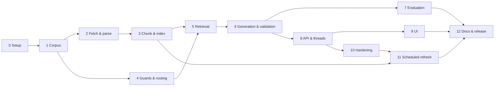

# Implementation Plan: Mutual Fund FAQ Assistant

This plan turns [architecture.md](architecture.md) into an ordered set of build phases. Each phase lists its goal, tasks, the files it produces, how it is tested, and the exit criteria that must be met before the next phase starts. Requirement IDs (G1–G7) refer to the goals in [architecture.md §1](architecture.md#1-goals-and-non-goals); the underlying requirements are in [problemStatement.md](problemStatement.md).

---

## Phase Overview

| Phase | Name | Main output | Depends on | Est. effort |
|-------|------|-------------|------------|-------------|
| 0 | Project setup | Repo skeleton, config loading, tooling | — | 0.5 day |
| 1 | Corpus definition | `sources.yaml`, `aliases.yaml`, education links | 0 | 1 day |
| 2 | Ingestion: fetch & parse | Raw snapshots, `scheme_facts` table, parser tests | 1 | 2–3 days |
| 3 | Ingestion: chunk & index | Section-based chunks, Chroma (cosine) + BM25 indexes, `python -m ingest` | 2 | 1–1.5 days |
| 4 | Guards & routing | PII guard, classifier, scheme resolver, reply templates | 1 | 1.5 days |
| 5 | Retrieval | Hybrid retriever with facts-first lookup and no-evidence rule | 3, 4 | 1 day |
| 6 | Generation, validation & formatting | Groq LLM call, validator, formatter, CLI | 5 | 2 days |
| 7 | Evaluation set | `eval/golden.yaml`, `eval/run.py`, tuned thresholds | 6 | 1.5 days |
| 8 | API & multi-thread support | FastAPI endpoints, thread store, per-thread locking | 6 | 1.5 days |
| 9 | User interface | Chat page with threads, welcome, examples, disclaimer | 8 | 2 days |
| 10 | Hardening & operations | Rate limits, logging, index hot-reload, retention job | 8 | 1 day |
| 11 | Scheduled data refresh | GitHub Actions workflow: daily 10:00 IST ingest → gate → publish data bundle; server pulls it | 3, 10 | 1.5 days |
| 12 | Documentation & release | README, final eval run, demo | All | 1 day |

Total: roughly **16–19 working days** for one developer. Phases 4 and 2–3 can run in parallel, as can 7 and 8.

---

## Phase 0 — Project Setup

**Goal:** a runnable, empty project with configuration, dependencies, and tests wired up, so every later phase only adds code.

**Tasks**
- [ ] Create the folder layout from [architecture.md §14](architecture.md#14-project-structure): `backend/app`, `backend/ingest`, `backend/tests`, `config`, `eval`, `frontend`, `data`.
- [ ] Initialise git; add `.gitignore` covering `data/`, `.env`, `__pycache__/`, `.venv/`, `node_modules/`.
- [ ] Create `pyproject.toml` (or `requirements.txt`) with: `fastapi`, `uvicorn`, `httpx`, `playwright`, `selectolax`, `beautifulsoup4`, `pdfplumber`, `sqlalchemy`, `chromadb`, `rank-bm25`, `sentence-transformers`, `rapidfuzz`, `groq`, `pydantic-settings`, `pyyaml`, `apscheduler`, `pytest`, `pytest-asyncio`.
- [ ] Write `backend/app/config.py`: loads `config/settings.yaml` into a typed Pydantic settings object, with environment-variable overrides (`GROQ_API_KEY`, `APP_ENV`, `DATABASE_URL`).
- [ ] Add `config/settings.yaml` with the defaults from [architecture.md §11](architecture.md#11-configuration).
- [ ] Add `.env.example` listing the required environment variables (no real values).
- [ ] Add a formatter/linter (`ruff`) and a one-line test that imports the config.

**Files:** `pyproject.toml`, `.gitignore`, `.env.example`, `config/settings.yaml`, `backend/app/config.py`, `backend/tests/test_config.py`

**Exit criteria**
- `pip install -e .` (or `pip install -r requirements.txt`) succeeds in a fresh virtual environment.
- `pytest` runs and passes.
- `playwright install chromium` has been run once.

---

## Phase 1 — Corpus Definition

**Goal:** a complete, reviewed allowlist of sources and scheme aliases.

**Citation policy (decided):** scheme answers and performance-query links cite the scheme's Groww page from the problem statement. General, statement-download, and refusal answers cite AMFI, SEBI, or RTA pages. See [architecture.md §2.3](architecture.md#23-citation-policy-decided).

**Tasks**
- [ ] Set `citation_policy: groww` in `config/settings.yaml` and write a short note for the README explaining that Groww is cited deliberately, despite the "official sources only" and "one AMC" lines in the problem statement.
- [ ] Check Groww's terms of use and `robots.txt` for the scheme pages. If automated fetching isn't allowed, plan to save the pages manually (Phase 2 supports this).
- [ ] Write `config/sources.yaml` with one entry per URL:
  - [ ] The 19 Groww scheme pages (`type: scheme_page`, `render: static` — the pages are server-rendered, see [corpus-review.md](corpus-review.md) — with `scheme_id` and `amc`). These are the citation links for every scheme answer.
  - [ ] AMFI investor-education pages covering expense ratio, exit load, riskometer, SIP, and ELSS lock-in (`type: amfi`).
  - [ ] SEBI investor pages for general guidance and refusal links (`type: sebi`).
  - [ ] CAMS / KFintech CAS and capital-gains statement pages, plus AMC "download statement" help pages (`type: rta_help`).
- [ ] Assign each scheme a stable `scheme_id` slug (e.g. `absl-large-cap`, `ppfas-flexi-cap`).
- [ ] Write `config/aliases.yaml`: for each `scheme_id`, the common names users will type — AMC short forms ("ABSL", "Birla", "Aditya Birla", "PPFAS", "Parag Parikh", "ICICI Pru"), old names ("Birla Sun Life Equity", "Parag Parikh Long Term Value", "HDFC Equity Fund"), and abbreviations.
- [ ] Write `config/education_links.yaml`: topic → AMFI/SEBI URL map used by refusal replies (choosing a fund, risk, SIP basics, tax, default).
- [ ] Write a small validator script (`python -m ingest.check_sources`) that checks: unique IDs, valid URLs, every scheme has exactly one Groww page, every alias points to a real `scheme_id`.

**Files:** `config/sources.yaml`, `config/aliases.yaml`, `config/education_links.yaml`, `backend/ingest/check_sources.py`

**Exit criteria**
- `citation_policy: groww` set and the README note drafted.
- `sources.yaml` covers all 19 schemes plus at least 10 official AMFI/SEBI/RTA pages.
- `check_sources` passes.
- Every URL opens in a browser (manual spot check).

---

## Phase 2 — Ingestion: Fetch & Parse

**Goal:** saved snapshots of every source and a populated `scheme_facts` table with provenance on every fact.

**Tasks**

*Fetcher* ([architecture.md §5.1](architecture.md#51-fetcher))
- [ ] `fetcher.py`: reads `sources.yaml`, fetches each URL with `httpx` (`render: static`) or Playwright (`render: browser`).
- [ ] Polite fetching: descriptive User-Agent, rate limit from config (default 2 s), 3 retries with exponential backoff, `robots.txt` check.
- [ ] Save to `data/raw/<source_id>/<YYYY-MM-DD>.html|pdf`; record SHA-256 hash and `fetched_at` in a `sources` table.
- [ ] Skip downstream processing when the hash is unchanged.
- [ ] Support a `--from-disk` mode that uses manually saved files in `data/raw/` instead of fetching.
- [ ] On fetch failure, keep the previous snapshot and its old `fetched_at`; log the failure.

*Storage*
- [ ] SQLAlchemy models in `backend/app/store/models.py`: `sources`, `scheme_facts` (fields from [architecture.md §5.2](architecture.md#52-parser-and-normaliser)).
- [ ] Enable SQLite WAL mode on connect.

*Parsers*
- [ ] `parsers/groww.py`: extract the scheme fields. Try the embedded page JSON first; fall back to label-based CSS selectors; leave a field `NULL` if neither works.
- [ ] `parsers/generic.py`: cleaned readable text and headings from AMFI, SEBI, and RTA pages (no structured fields).
- [ ] Normalisation: keep values as published (`"0.98%"`, `"₹100"`) and also store a parsed numeric value for expense ratio and minimum amounts.
- [ ] Record the scheme name shown on each Groww page as the canonical `scheme_name`, and the page URL as the fact's `source_url`.
- [ ] Extract and retain **everything** on each scheme page ([architecture.md §2.4](architecture.md#24-data-policy-extract-everything-restrict-only-interpretation-decided)): the full embedded data object (`scheme_snapshots`), every published number with basis, period and as-of date (`scheme_metrics`: NAV, AUM, annualised/absolute/SIP returns, category averages, ranks, risk ratios), holdings, similar funds, fund-manager profiles, expense-ratio history, all other fields (`scheme_attributes`), and Groww's PROS/CONS flagged as judgements (`scheme_analysis`).
- [ ] Cross-check stored returns, category averages and ranks against the page's visible returns table; mark disagreements `displayed = False` with a review note.

*Tests*
- [ ] Save one snapshot per parser type under `backend/tests/fixtures/`.
- [ ] Snapshot tests assert each extracted field for each fixture.
- [ ] Test that a missing label produces `NULL`, not a wrong value.

**Files:** `backend/ingest/fetcher.py`, `backend/ingest/parsers/*.py`, `backend/app/store/models.py`, `backend/app/store/db.py`, `backend/tests/fixtures/*`, `backend/tests/test_parsers.py`

**Exit criteria**
- All sources fetched (or loaded from disk) with snapshots saved.
- For every scheme, `expense_ratio`, `exit_load`, `min_sip`, `riskometer`, and `benchmark` are populated, or the `NULL` is explained in a review note.
- Manual check: 10 random facts compared against the live pages, all correct.
- Parser snapshot tests pass.

---

## Phase 3 — Ingestion: Chunk & Index

**Goal:** searchable vector and keyword indexes over all source text, rebuilt by one command.

**Design basis:** [chunking-research.md](chunking-research.md) profiled `data/parsed/` and benchmarked 3 chunking strategies, 4 embedding models and dense/BM25/hybrid retrieval on 44 labelled queries. Findings:
- Packing ~400-token windows across headings ranks the right section first less often (hit@1 0.82 vs 0.91–0.95) and sends 3.2× more evidence tokens to Groq.
- 29 parsed sections exceed bge-small's 512-token input limit and would be silently truncated.
- Portfolio holdings make up 60% of Groww text, and that data is already structured in SQL.

The tasks below adopt the section-based design (strategy C).

**Tasks**

*Chunker* ([architecture.md §5.3](architecture.md#53-chunker)): **done 2026-11-09** in `backend/ingest/chunker.py`. Run `python -m ingest.chunker [--show-dropped] [--out chunks.jsonl]` to chunk `data/parsed/` and print a summary. On current data: 387 chunks (311 scheme, 65 AMFI, 9 SEBI, 2 RTA), median 99 tokens, max 348, 127 sections dropped (103 answered from SQL, 12 stubs, 8 nav headings, 3 menus, 1 personal data). PII patterns are in `backend/app/pipeline/pii_patterns.py`, for the Phase 4 guard to reuse.
- [x] `chunker.py`: **one chunk per parsed section; never merge sections.** Split only sections over **350 tokens** (measured with the bge tokenizer):
  - scheme pages: split at `;` and sentence boundaries, repeating the lead sentence (scheme name) in every piece, with no overlap;
  - prose pages: split at sentence boundaries with one sentence of overlap.
- [x] Prepend the header `"[<scheme name or source title>] <section heading>"` to every chunk, used for both embedding and BM25. Add a fixed synonym tail to the standard Groww headings, e.g. `Costs and exit load (expense ratio, TER, charges, exit load, stamp duty)` and `Investment limits and lock-in (minimum SIP, monthly investment, lumpsum, lock-in)`.
- [x] **Exclude from the text index** content that is answered from SQL by the facts-first lookup:
  - `Portfolio holdings *` → `scheme_holdings`;
  - `Similar funds listed on Groww` → `scheme_peers`, because it contains other schemes' figures.
- [x] **Noise filter** (deterministic, with each drop logged with its reason):
  - navigation headings (`Dark`, `View More`, `Videos`, `Quick Links`, `Media`, `Other Links`);
  - menu-like blocks (≥ 6 lines, > 60% of them ≤ 4 words, **and** < 30% of words in lines of ≥ 12 words). The prose condition was added during implementation: without it, the glossary's "Expense Ratio" entry, which is prose plus a flattened TER table, was dropped as a menu;
  - `"Navigated to …"` lines;
  - sections under 12 tokens;
  - any section matching the Phase 4 PII patterns (phone, email, PAN). This removes, for example, the AMFI awareness-programme schedule, which lists contact persons' mobile numbers.
- [x] Chunk metadata:
  - `chunk_id` (deterministic: `<source_id>::<section_slug>::<n>`);
  - `source_id`, `source_url`, `scheme_id`, `amc`, `doc_type`, `section`, `fetched_at`;
  - `section_kind` (`facts | returns | risk | manager | fund_house | identifiers | objective | prose`);
  - `as_of` (returns and NAV sections);
  - `chunker_version`.

*Indexer* ([architecture.md §5.4](architecture.md#54-indexing)): **done 2026-11-09** in `backend/ingest/indexer.py` and wired into `python -m ingest`. Files: `data/chroma/`, `data/bm25.pkl`, `data/index_manifest.json`. From a clean `data/` (raw snapshots only), the first run takes 45 s and a repeat run 7 s with nothing re-embedded and identical `chunk_id`s. Additions beyond the plan:
  - **Chroma ignores `embedding_function=None`.** An `add`/`query` without embeddings still downloads and runs its default MiniLM (verified), so `upsert` refuses to run without precomputed embeddings and queries always pass `query_embeddings`.
  - **Chunk `fetched_at` comes from the `sources` table.** Unchanged pages aren't re-parsed, so `data/parsed` keeps the date the content last *changed*; footers must show the last *confirmed* fetch.
  - Sources are re-embedded only when their chunk ids or texts change (content hash in the manifest, checked against the ids actually stored). Otherwise only metadata is updated, and sources gone from the corpus are deleted.
  - `--no-index` skips indexing. A failed run is repaired by the next one, because stored ids are re-verified per source.
- [x] `indexer.py`: embed with `BAAI/bge-small-en-v1.5`, normalised, `max_seq_length = 512`. Store the query instruction `"Represent this sentence for searching relevant passages: "` in config. It is applied to **queries only**, never to passages; it raised hybrid hit@1 from 0.89 to 0.95.
- [x] Chroma (persistent, `data/chroma/`, one collection):
  - create it with `metadata={"hnsw:space": "cosine"}` (the default is L2). Always pass precomputed embeddings: `embedding_function=None` alone does not stop Chroma from loading its default model (see the note above);
  - score = `1 − distance`.
- [x] Write an index manifest (embedding model, dimension, query instruction, `chunker_version`). If any of these differs from config, rebuild the collection from scratch instead of upserting.
- [x] Put Chroma behind a small `VectorIndex` interface (`upsert`, `delete_source`, `query(text, where, k)`) so a NumPy backend can replace it if needed.
- [x] Re-ingesting a source runs `delete(where={"source_id": …})` then `add`, so stale chunks never linger.
- [x] BM25: rebuild the whole index on every run (under 1 s) and persist it with its chunk-ID list to `data/bm25.pkl`. The tokenizer lowercases and keeps decimals and amounts (`0.70`, `1.5`, `100`).
- [x] Config additions to `settings.yaml`:
  - `retrieval.query_instruction`;
  - `chunking.max_tokens: 350`, `chunking.min_tokens: 12`, `chunking.exclude_sections` and `chunking.version` (added with the chunker).
- [x] Change `min_relevance` from 0.35 to a starting value of **0.60**. bge cosines rarely fall below 0.45, so 0.35 never triggers. The final value is tuned in Phase 7, and the full no-evidence rule is built in Phase 5 (see [chunking-research.md §4.1](chunking-research.md#41-relevance-scores-and-the-no-evidence-threshold)).
- [x] `ingest/__main__.py`: `python -m ingest [--from-disk] [--only <source_id>] [--rebuild-index]` runs fetch → parse → chunk → index. It prints a summary: sources processed, facts extracted, chunks indexed, sections dropped by reason, and failures.

*Prerequisite from Phase 2 (done 2026-11-09):* the AMFI glossary snapshot stopped at A–D because only page 1 of its numbered pagination was fetched. The fetcher now supports a `paginate` block in `sources.yaml` and merges all pages into one snapshot; the glossary has all 27 terms.

*Tests*
- [x] Chunker (`backend/tests/test_chunker.py`, 22 tests):
  - no chunk exceeds 350 tokens;
  - every chunk has its header and full metadata;
  - every scheme-page piece starts with the scheme name;
  - holdings and similar-funds sections are absent;
  - each noise rule drops its fixture example;
  - no chunk matches a PII pattern.
- [x] Indexer (`backend/tests/test_indexer.py`, 18 tests, one `slow` test with the real model):
  - re-ingesting a source doesn't duplicate chunks, and `chunk_id`s are stable across runs;
  - a manifest mismatch triggers a rebuild;
  - the collection's distance space is cosine.
- [x] Retrieval benchmark against the built index: `cd backend && python ../eval/research/index_bench.py`. Queries are in `eval/research/retrieval_queries.yaml`; results are in `eval/research/index_bench_2026-11-09.json`.
  - **Text-answerable queries (42):** hybrid hit@1 0.952, hit@5 1.00; dense hit@1 0.929; BM25 hit@1 0.786.
  - **All 44, raw:** hit@1 0.909, hit@5 0.955.
  - **Holdings and similar-funds queries** are tagged `answered_from: sql`, reported separately, and confirmed absent from the text index.
  - **Label fix:** "What is an exit load?" now also accepts the glossary's Exit Load entry, which entered the corpus after the labels were written.
  - **Remaining ranking weaknesses (rank 2–3):** "how much … monthly in ppfas" and "how risky is HDFC corporate bond". Phase 4's field-intent mapping should route these.

**Files:**
- `backend/ingest/chunker.py`, `backend/ingest/indexer.py`, `backend/ingest/__main__.py`
- `backend/tests/test_chunker.py`, `backend/tests/test_indexer.py`
- `eval/research/index_bench.py`, `eval/research/retrieval_queries.yaml`

**Exit criteria**
- [x] `python -m ingest` completes end to end from a clean `data/` directory. *(Verified 2026-11-09 with a live fetch into an empty directory: 38/38 sources fetched and parsed in 114 s, facts for 19 schemes, 387 chunks indexed in 45 s. A repeat index run took 3 s with nothing re-embedded. The chunk IDs are identical to the project's index.)*
- [x] Running it twice in a row gives the same chunk count and the same `chunk_id`s. On current data, expect about 380 chunks, median about 90 tokens, max ≤ 350. *(Actual: 387 chunks, median 99, max 348.)*
- [x] On the 44-query research set: scoped hybrid hit@5 ≥ 0.95 and hit@1 ≥ 0.90 (on the text-answerable queries).
- [x] Smoke query: "exit load Kotak Multi Cap" returns Kotak's `Costs and exit load` chunk first.

---

## Phase 4 — Guards & Routing

**Goal:** deterministic handling of PII, advisory, performance, out-of-scope, and greeting messages, and resolution of scheme names — all before any retrieval or answer generation. Covers G3, G4, G5.

Can be built in parallel with Phases 2–3; it only needs `aliases.yaml` and `education_links.yaml` from Phase 1.

**Status: done 2026-11-10.** 491 unit tests in `test_pii_guard.py`, `test_classifier.py`, `test_scheme_resolver.py`, `test_templates.py` and `test_router.py`; every PII, advisory and performance phrase routes correctly with the LLM layer stubbed. Additions beyond the plan:
  - **`router.py`** chains PII guard → resolver → classifier and returns either a finished template reply or a `RetrievalRequest` for Phase 5. It also says what the thread stores: the placeholder for a blocked message, the new `active_scheme_id`, and `pending_candidates` after a clarifying question (closes the RES-09 gap; Phase 8 needs a column for it).
  - **`catalog.py`** loads schemes, AMCs, education links and per-source fetch dates once; **`text.py`** holds the Unicode normaliser (zero-width, full-width and Devanagari digits) and the sentence splitter that Phase 6's validator can reuse.
  - The resolver runs before the classifier, because the classifier needs to know whether a scheme was named. It never sends text anywhere, so the PII guard still runs first.
  - The LLM classifier is asked only when the rules are not decisive. When it fails or returns an unknown class, the router stays on the factual route (CLS-60/61). A factual rule match can't be downgraded to greeting or out of scope (CLS-63).
  - Uncovered schemes are never guessed (RES-10, CLS-30). Fuzzy matching compares word by word, a list of uncovered AMCs returns `not_covered`, and an AMC + qualifier ("HDFC Gold ETF FoF") must appear in a covered scheme's name.
  - Extra PII kinds: UPI IDs, masked identifiers and bare 9+ digit runs (PII-14, PII-15, PII-28). Plan-not-covered template for Regular/IDCW questions (CLS-31). Clarifying questions list at most 5 names (RES-06).

**Tasks**

*PII guard* ([architecture.md §6.1](architecture.md#61-step-1--pii-guard-deterministic-runs-first))
- [x] `pii_guard.py`: regexes for PAN, Aadhaar, Indian phone numbers, email, OTP (digits near "OTP"/"code"/"pin"), account/folio numbers (long digit runs near "account"/"a/c"/"folio").
- [x] Returns `{blocked: bool, kinds: [...]}`. Never returns or logs the matched text.
- [x] Unit tests: ≥ 5 positive and ≥ 5 negative cases per PII type (e.g. "₹1000 SIP" and "NIFTY 100" must not be blocked).

*Classifier* ([architecture.md §6.2](architecture.md#62-step-2--query-classifier))
- [x] `classifier.py` rule layer: keyword/regex patterns for `advisory`, `performance_judgement` ("performing well", "good returns", "better than"), `greeting`, and obvious `out_of_scope` topics. Plain metric questions ("3-year return", "NAV", "AUM", "top holdings") are `factual_metric`, not refusals.
- [x] LLM layer: a short Groq call (`AsyncGroq`, model from config, temperature 0, JSON output with an enum `class` field) for messages the rules don't settle. Stubbed in tests.
- [x] Combine rule: the more restrictive class wins (`advisory` > `performance_judgement` > `factual_*`).
- [x] Unit tests for the rule layer: ≥ 15 advisory, ≥ 10 performance-judgement, ≥ 15 factual and ≥ 10 metric phrasings.

*Scheme resolver* ([architecture.md §6.3](architecture.md#63-step-3--scheme-resolver))
- [x] `scheme_resolver.py`: alias lookup + `rapidfuzz` matching with a confidence threshold.
- [x] Follow-up support: fall back to the thread's `active_scheme_id` when the message has a reference ("its", "this fund") but no scheme name.
- [x] Ambiguity: return all candidates when several match ("the large cap fund"), so the pipeline can ask a clarifying question.
- [x] Field-intent detection: keyword map from user wording to `scheme_facts` fields ("TER"/"expense"/"charges" → `expense_ratio`, etc.) and to metrics with period and basis ("3-year return" → `return`/`3y`/`annualised`, "absolute", "SIP return", "NAV", "AUM", "rank", "Sharpe", "holdings").
- [x] Unit tests: every alias resolves correctly; ambiguous phrases return multiple candidates; follow-ups use the thread context.

*Reply templates* ([architecture.md §6.8](architecture.md#68-refusal-and-special-route-replies))
- [x] `templates.py`: advisory refusal, performance-judgement refusal (Groww scheme page link), out-of-scope, greeting, PII-blocked, no-evidence, clarifying question, the deterministic fact template ("The <field> of <scheme> is <value>.") and a metric template ("The <label> of <scheme> was <value> as of <date>, as published by Groww.").
- [x] Each template returns the same structured shape as a generated answer (`answer`, `citation_url`, `last_updated`, `type`).
- [x] Unit tests: every template is ≤ 3 sentences and has exactly one URL.

**Files:** `backend/app/pipeline/pii_guard.py`, `classifier.py`, `scheme_resolver.py`, `templates.py`, `router.py`, `catalog.py`, `text.py`, and matching tests

**Exit criteria**
- All unit tests pass.
- 100% of the PII, advisory, and performance test phrases route correctly with the LLM layer stubbed out.

---

## Phase 5 — Retrieval

**Goal:** given a resolved question, return the best evidence — structured facts first, then text chunks — or decide there is no evidence. Covers G1.

**Status: done 2026-11-10.** `backend/app/pipeline/retriever.py`; 32 tests in `test_retriever.py` (24 fast with fake indexes and a temporary database, 8 `slow` against the real Phase 3 indexes). All 20 hand-written factual questions find the right evidence, all of them as `E1`. Additions beyond the plan:
  - **No-evidence rule has two parts.** Without a fact, the best dense cosine must reach `min_relevance` *and* at least half of the question's content words (no stopwords, numbers or scheme-name words) must appear in the retrieved chunks. Within one scheme every chunk scores 0.72–0.89 just for sharing the scheme name, so the cosine alone cannot reject "What is the colour of HDFC Flexi Cap?" (nonsense measured 0.735–0.779). General questions do separate on cosine (0.42–0.47 vs 0.63–0.75), so `min_relevance: 0.60` stays. The threshold applies to the dense cosine, never to the RRF score (RET-04).
  - **Evidence blocks** carry `source_url`, `fetched_at` (fact dates use the last *confirmed* fetch from the `sources` table), and structured `data` (fact values, metric rows with label/basis/period/as-of, holdings) for the Phase 6 validator and fact-template fallback.
  - **Metrics:** an exact period + basis row when asked; without a period, the figures the page displays. Hidden fields (Sharpe, beta, …) are marked "from Groww's page data". Holdings: top 10 with portfolio date. Similar funds: names only, excluding the scheme itself, which Groww lists among its own peers.
  - **General questions** search only AMFI/SEBI/RTA documents, even when a scheme is named (RET-05); BM25 and dense hits are also post-filtered (RET-03); RRF ties break on `chunk_id` (RET-12). Short follow-ups are rewritten with the scheme name and field (RET-10).
  - **Fixes elsewhere:** the embedder loads the cached model first (startup 63 s → ~15 s on a slow connection), and the resolver treats "How is the riskometer of a scheme derived?" as a concept question rather than asking which scheme.

**Tasks** ([architecture.md §6.4](architecture.md#64-step-4--hybrid-retrieval))
- [x] `retriever.py` facts lookup: if a scheme and a field are resolved, read that `scheme_facts` row and turn it into an evidence block with its `source_url` and `fetched_at`. For a metric question, read the matching `scheme_metrics` rows (or holdings / peers) and include label, basis, period and as-of date in the evidence block.
- [x] Chunk search: rewrite the query with the canonical scheme name; query Chroma (top 8, filtered by `scheme_id` when known) and BM25 (top 8); merge with Reciprocal Rank Fusion; keep the top 5.
- [x] General questions (no scheme): search only `amfi`, `sebi`, and `rta_help` documents.
- [x] Run embedding and BM25 work in a thread pool so it doesn't block the async event loop.
- [x] No-evidence rule: if there's no fact and the best chunk score is below `min_relevance`, return `no_evidence` with the most relevant scheme or AMFI URL for the reply template.
- [x] Evidence blocks are numbered (`E1`, `E2`, …) and each keeps its `source_url` and `fetched_at`, so the formatter can cite whichever one the model chooses.
- [x] Citation URLs follow `citation_policy: groww`: scheme evidence blocks carry the scheme's Groww page URL; general evidence blocks carry their AMFI, SEBI, or RTA page URL.

*Tests*
- [x] Facts-first: a known field question returns the fact as `E1`.
- [x] Scheme filter: a Kotak question never returns chunks from other schemes.
- [x] No-evidence: a nonsense question ("What is the colour of HDFC Flexi Cap?") returns `no_evidence`.

**Files:** `backend/app/pipeline/retriever.py`, `backend/tests/test_retriever.py`

**Exit criteria**
- Tests pass against the real indexes from Phase 3.
- For 20 hand-written factual questions, the correct evidence is in the returned blocks for at least 19.

---

## Phase 6 — Generation, Validation & Formatting

**Goal:** a complete end-to-end pipeline that turns a message into a compliant reply, usable from the command line. Covers G1, G2, G3, G4.

**Status: done 2026-11-10.** Model `openai/gpt-oss-120b` on Groq (free tier: 30 RPM, 1K RPD, 8K TPM, 200K TPD). New modules `llm.py`, `generator.py`, `validator.py`, `formatter.py`, `orchestrator.py`, `app/cli.py`; 759 tests pass (88 new for this phase, LLM always mocked). Manual run with the real API: 18 questions across every route, every reply ≤ 3 sentences with one link and the footer; no advice or judgement; every figure matched stored data with basis and date. Additions beyond the plan:
  - **Request shape (verified against the API):** strict `json_schema` output, `temperature: 0`, `reasoning_effort: low`, `include_reasoning: false`, `max_completion_tokens` (reasoning tokens count towards it). One answer costs ~1.0–1.3K tokens (prompt ~950–1,250 + completion ~80–220, of which ~25 reasoning), ~0.6 s.
  - **`llm.py`: one shared client for the classifier and the generator,** with a client-side sliding-window limiter for all four limits, a concurrency semaphore (2), one retry on 429/5xx/network errors honouring `retry-after`, and a JSON log line per call (purpose, tokens, latency, finish reason; never text). **8K TPM is the binding limit: about 6 answers per minute.** Beyond that a request waits up to `max_wait_seconds` (30) and then falls back. Batch jobs (the Phase 7 eval) should raise `max_wait_seconds` so they wait instead of falling back.
  - **Token savings:** the classifier's LLM second opinion runs only when the rules are unsure (no field, metric or process keyword), saving ~450 tokens per factual message; evidence sent per answer is capped at `max_evidence_tokens: 1000` (structured facts always kept).
  - **Fallbacks:** retry once on schema / evidence-id / figures / basis-and-date / fact-consistency failures; then the deterministic fact or metric template. If the LLM is unavailable and no template fits, a new honest `unavailable` reply ("try again in a minute") links the most relevant source instead of claiming there is no evidence.
  - **CLI:** `python -m app.cli [--thread NAME] [--reset] [--no-llm] [--json] [-v] "question"`; thread state in `data/cli_threads/`.
  - **Fixes elsewhere:** relative `sqlite:///data/app.db` in `.env` is now anchored at the project root (running from `backend/` silently opened an empty database); the classifier's Groq call moved onto the shared client (its old `max_tokens=30` left no room for gpt-oss reasoning tokens).

**Tasks**

*Generator* ([architecture.md §6.5](architecture.md#65-step-5--answer-generation-groq))
- [x] `generator.py`: one `AsyncGroq` chat-completions call with:
  - model from config (`llm.model`: `openai/gpt-oss-120b`), `temperature: 0`, JSON output (`response_format` JSON schema where the chosen model supports it, otherwise JSON mode) for `{answer, evidence_id, answerable}`;
  - the fixed system prompt (static text);
  - the last `history_messages` thread messages, then a user turn with labelled evidence blocks and the question;
  - `finish_reason` checked before reading content (`length` → treated as a schema failure).
- [x] Use the official `groq` SDK only; follow its documented calls for JSON output.
- [x] Because JSON mode does not guarantee the schema, parse and validate the response with Pydantic; a parse failure goes to the validator's retry-once path.
- [x] Handle API errors by type (rate limit / server error → one retry, honouring `retry-after`; others → fallback reply). Never surface raw errors to the user. Groq free-tier rate limits are low, so keep a semaphore on concurrent LLM calls.

*Validator* ([architecture.md §6.6](architecture.md#66-step-6--response-validator))
- [x] `validator.py` checks: schema, `answerable`, valid `evidence_id`, ≤ 3 sentences (splitter aware of "Rs.", "e.g.", decimals), no URLs, no advice phrases, no judgement language about performance, every number present in the cited evidence, returns stated with basis and date, fact consistency.
- [x] Failure actions as specified: retry once, strip, replace with template, or fall back to the deterministic fact template.

*Formatter* ([architecture.md §6.7](architecture.md#67-step-7--formatter))
- [x] `formatter.py`: builds `answer` + `Source: <url>` + `Last updated from sources: <DD Mon YYYY>` from the chosen evidence block; returns both structured fields and rendered text.

*Pipeline orchestrator*
- [x] `pipeline/__init__.py` (`answer_message(thread_ctx, text)`): PII guard → classifier → resolver → retriever → generator → validator → formatter, with short-circuits to templates.
- [x] Returns the reply and the updated `active_scheme_id`.

*CLI*
- [x] `python -m app.cli "What is the exit load of Kotak Multi Cap?"` prints the reply and the route taken. A `--thread` flag keeps context across invocations for testing follow-ups.

*Tests*
- [x] Validator unit tests: one failing and one passing case per rule.
- [x] Formatter tests: footer date matches the cited evidence's `fetched_at`; exactly one URL.
- [x] Integration tests with the Groq call mocked: each route produces the right reply type.
- [x] Manual run with the real API: 10 questions across all routes, results reviewed by hand.

**Files:** `backend/app/pipeline/llm.py`, `generator.py`, `validator.py`, `formatter.py`, `orchestrator.py`, `__init__.py`, `backend/app/cli.py`, `backend/tests/test_llm.py`, `test_validator.py`, `test_formatter.py`, `test_answer_pipeline.py`, `test_cli.py`, `fake_groq.py`

**Exit criteria**
- Every reply from the CLI (any route) is ≤ 3 sentences, has exactly one link, and ends with the footer.
- No reply in the manual run contains advice or judgements of performance; every figure stated matches stored data and carries its basis and date.
- Token usage (`usage.prompt_tokens`, `usage.completion_tokens`) is logged per call. Groq has no explicit prompt-cache control, so none is configured.

---

## Phase 7 — Evaluation Set

**Goal:** a repeatable measure of accuracy and compliance, used to tune thresholds and to gate the release. Directly measures the Success Criteria in the problem statement.

**Status: built 2026-11-10; all gates met, but by case-level re-runs (see Results). One clean full run is still to do.**

*Tools*
- `eval/golden.yaml` has **150 cases**: 62 scheme facts (every scheme, including old names, short forms and typos), 16 general facts, 15 advisory, 15 metrics, 10 performance-judgement, 10 PII, 10 follow-up threads (one with 3 turns, one through a clarifying question) and 12 other routes.
- The `other_routes` bucket covers: greeting, out of scope, not covered, clarify, Regular plan, the NULL expense ratio that must never be stated, and unanswerable questions that pass retrieval.
- `python eval/run.py` checks, per reply:
  - route (reply type), scheme, citation and values;
  - basis and as-of date for metrics;
  - the format rules: ≤ 3 sentences, one allowlisted link, footer date equal to the cited source's fetch date;
  - no advice or judgement wording;
  - no message text in the logs;
  - for PII: blocked, only the placeholder stored, **no LLM call**, and the detail absent from logs and trace.
- `run.py` options:
  - `--no-llm`: free; runs routing, templates and format, and skips replies that need the model;
  - `--bucket`, `--case id|prefix*`, `--rerun-failures <results.json>`;
  - `--set key=value` to try settings;
  - `--compare <results.json>`.
- Each run saves `eval/results/<date>[-nollm][-partial][-N].json`. A reply produced while Groq was unavailable is flagged, so it isn't mistaken for a pipeline failure.
- `python eval/verify_golden.py` checks every expected value against the **raw page snapshot**, not the parsed tables, so a parser bug can't make the golden set agree with itself. Numbers must match exactly and sit near a label for the asked field: a scheme page has hundreds of figures. `sf-kotak-lockin` carries a `verify_note`: the page publishes `lock_in` as nulls, which is stored as "No lock-in".
- `python eval/tune.py` sweeps `min_relevance` and the resolver's fuzzy thresholds without the LLM. Results are in `eval/results/tuning-<date>.json`.
- `backend/tests/test_eval_checks.py` (36 tests) covers the matching rules and the golden file's validity.

*Tuning*
- **`min_relevance` stays 0.60.**
  - 0.40–0.65 give no false refusals. The lowest answerable general question scores 0.673, and the tuner keeps 0.05 below it.
  - Cosine only separates **general** questions. General unanswerable questions that mention mutual funds still score 0.71–0.74, overlapping answerable ones (0.67–0.75).
  - Scheme-scoped nonsense scores 0.79–0.83, above every answerable scheme question.
  - Those cases are left to the content-word rule and the model's `answerable` flag, which caught all 4 such golden cases.
- **Fuzzy matching stays at 88/75.** 80–92 behave the same on 97 scheme mentions, 12 typos and 15 uncovered names.
  - The one typo not resolved, "Sun **Lfe**", has a ≤ 3-letter word, which must match exactly by design.
  - The only wrong resolutions weren't fuzzy at all (see below).

*Bugs found and fixed (each with regression tests)*
- **Classifier rules:**
  - "how much do I need to invest **at minimum**", "how much **deduction** can I claim" and "who should I **update** my PAN with" were refused as advice;
  - "done well **compared to its peers**" was refused as advice instead of performance;
  - "are the … returns **impressive**?" wasn't seen as a judgement and was answered with a figure.
- **Resolver:**
  - ELSS/80C questions and "how many levels / how often …" questions asked "which scheme?" instead of answering generally;
  - **"Kotak Emerging Equity Fund" and "Bandhan Sterling Value Fund" resolved to the AMC's one covered scheme.** Now not covered: a new rule treats AMC + unknown words + "fund" as an uncovered scheme, and the scheme-name vocabulary is wider.
- **Retriever:** "instalment" didn't match "installment", and "according to AMFI" counted as content words.
- **Validator:** missed "returns **are strong**" (predicate form). It now also requires the as-of date for **any** metric or holdings figure (a rank was stated without its date).
- **Generator (biggest effect):**
  - 10 scheme-fact questions using **old names or short forms** ("HDFC Equity Fund", "Reliance Large Cap", "ICICI Pru Bluechip", "TER") came back `answerable=false`, because the evidence names the scheme differently.
  - The user turn now carries `Resolved: <canonical name> (Direct Plan - Growth); asked about: <field>`, and the system prompt says it is authoritative.
  - If the model still says unanswerable while a stored fact or figure for the asked field is in the evidence, the deterministic template answers (`fallback_used: unanswerable_with_fact`).
- **Thread context:**
  - "And for Bandhan Small Cap?" and the reply "the ICICI one" to a clarifying question named a scheme but no field.
  - `ThreadContext.last_intent` now carries the previous question's fields and metrics into elliptical follow-ups (an answer to a clarifying question, a turn starting "and / what about / for", or ≤ 4 words).
  - **Phase 8's thread table needs a `last_intent` column** (JSON; `intent_to_dict` / `intent_from_dict`).
- **New holdings template** (top 5 with portfolio date), so holdings questions have a deterministic fallback too.

*Results* (model `openai/gpt-oss-120b`, Groq free tier)

| Run | Cases | Result | File |
|-----|-------|--------|------|
| Full, real API | 150 | PII / advisory / performance / format **100%**, other routes 100%, factual **86.0%**, follow-ups **80.0%** (gates not met). 128 LLM calls, 133K tokens, no LLM-unavailable replies | `eval/results/2026-11-10.json` |
| Re-run of the 15 failures, after the generator and validator fixes | 15 | 12 fixed | `eval/results/2026-11-10-partial.json` |
| All follow-up threads + holdings, after the thread-context fix | 11 | 11 / 11 | `eval/results/2026-11-10-partial-2.json` |
| Full, `--no-llm`, after all fixes | 150 | every gate met, no failures (replies needing the model are skipped) | `eval/results/2026-11-10-nollm.json` |

Taken case by case, all 150 cases now pass. But they passed under different code versions, and the generator prompt changed after the full run. **To do:** one clean full run of `python eval/run.py` once Groq's 200K tokens/day window has room (a run needs ~135K); the result goes in the README.

**Tasks** ([architecture.md §12.1](architecture.md#121-golden-evaluation-set))
- [x] Write `eval/golden.yaml` with ~120 cases (150 written):

  | Bucket | Count |
  |--------|-------|
  | Scheme facts (≈3 per scheme) | ~60 |
  | General facts (ELSS lock-in, CAS download, riskometer meaning) | ~15 |
  | Advisory | ~15 |
  | Metrics (returns, NAV, AUM, ranks, holdings) | ~15 |
  | Performance judgement (refusals) | ~10 |
  | PII | ~10 |
  | Multi-turn follow-ups | ~10 |

- [x] Each case records: input (or turn list), expected route, expected value (for facts, copied from the source page by hand, and checked against the raw snapshots by `verify_golden.py`), and expected citation URL.
- [x] `eval/run.py`: runs every case through the pipeline (real API), checks route, value, citation, sentence count, and footer, and prints pass rates per bucket plus a list of failures.
- [x] Tune `min_relevance` and the resolver's fuzzy-match threshold using the results (both kept; see Tuning).
- [x] Fix failures in the relevant phase's code; re-run until targets are met.
- [x] Save each run's results to `eval/results/<date>.json` so changes can be compared.
- [ ] One clean full real-API run with all fixes in place (Groq daily budget).

**Files:**
- `eval/golden.yaml`, `eval/checks.py`, `eval/run.py`, `eval/verify_golden.py`, `eval/tune.py`, `eval/results/`
- `backend/tests/test_eval_checks.py`

**Exit criteria**
- PII, advisory, performance-judgement, and format checks: **100%**. *(Met in the full run.)*
- Factual and metric accuracy (scheme + general + metrics): **≥ 95%**. *(86.0% in the full run; 100% after fixes, by case-level re-runs.)*
- Follow-ups: **≥ 90%** resolve to the correct scheme. *(Scheme resolution 100% throughout; full-pass 80% in the full run, 10/10 after the thread-context fix.)*

---

## Phase 8 — API & Multi-Thread Support

**Goal:** serve the pipeline over HTTP with many independent conversations running at once. Covers G6.

**Status: done 2026-11-10.**
- **Run it:** `cd backend && uvicorn app.main:app` (API at `/api/...`, OpenAPI page at `/docs`).
- **Tests:** 24 new (`test_api.py` 16, `test_concurrency.py` 4, plus history tests in `test_answer_pipeline.py`). The full suite passes: 842 fast + 18 slow. A `--no-llm` eval run still meets every gate.
- **Smoke test** against the real indexes, database and Groq: two threads used alternately stayed separate. The follow-up resolved, the advisory question was refused, and the PAN message was stored only as the placeholder.

Additions beyond the plan:
- **Thread state is the pipeline's whole `ThreadContext`.** The `threads` table has `active_scheme_id`, `pending_candidates` (clarifying questions, Phase 4) and `last_intent` (JSON, "and for X?", Phase 7). Follow-ups and clarifications therefore survive a server restart (tested).
- **Messages carry a per-thread `seq`,** so ordering never depends on timestamps, which can tie within one transaction. They also store the reply `route`.
- **One transaction per turn:** the user message, the reply and the new thread state are written together. A failed reply writes nothing.
- **Locking:**
  - `DELETE` takes the thread's lock too, so a reply in progress can't be written after its thread is deleted.
  - Each lock is dropped once nobody holds or waits for it.
  - Mutation check: with the lock disabled, the burst, delete-during-reply and lock tests fail.
- **Errors:** an unexpected error returns a generic 500 and logs only the exception type and location, never its message, which could echo the user's text. Logs never contain message text (tested).
- **Validation:** input is stripped; empty or whitespace-only gets 422. The length limit comes from `api.max_input_chars` (500), not a hard-coded constant.
- **New settings:** `api.cors_origins` (default: the Vite dev server). `GET /api/meta` also returns the PII notice and the input limit for the UI.
- **`GET /api/health`** reports `status: ok | degraded` (degraded when the indexes or the Groq key are missing) and each source's last fetch date. Flagging stale sources is Phase 10.
- **Bug found by the smoke test:** after "What is the ELSS lock-in period?", the model refused "How do I download my capital gains statement?" (`answerable=false`): it read the new question as being about ELSS.
  - History is now sent only to turns that lean on the conversation: resolved from thread context, a reply to a clarifying question, an inherited intent, or reference words ("its", "this fund", "what about").
  - Self-contained questions get none, which also saves tokens. The trace records `history_sent`.
- **Template fix:** the general no-evidence reply said "the AMFI investor-education pages" while linking whichever page was most relevant (e.g. CAMS). It now names none.

**Tasks**

*Thread store* ([architecture.md §7.2](architecture.md#72-storage-sqlite))
- [x] SQLAlchemy models for `threads` and `messages`; repository functions for create, get with history, append message, update `active_scheme_id`, delete. (Also `delete_idle(before)` for the Phase 10 retention job.)
- [x] PII-blocked messages stored only as the placeholder `[message withheld: contained personal information]`. The thread title then comes from the placeholder too.

*Endpoints* ([architecture.md §8](architecture.md#8-api-design))
- [x] `POST /api/threads`, `GET /api/threads/{id}`, `DELETE /api/threads/{id}`.
- [x] `POST /api/threads/{id}/messages`: validate input (1–500 chars), run the pipeline, store both messages, return the structured reply.
- [x] `GET /api/meta`: welcome text, three example questions, disclaimer text, list of covered schemes.
- [x] `GET /api/health`: status, index loaded, last ingestion date per source.
- [x] Pydantic request/response models; 404 for unknown thread IDs.

*Concurrency* ([architecture.md §7.3](architecture.md#73-concurrency))
- [x] Async handlers with a single shared `AsyncGroq` client and indexes loaded once at startup. Database calls run in a worker thread.
- [x] Per-thread `asyncio.Lock` (kept in a dictionary keyed by thread ID) so messages within one thread are processed in order.
- [x] CORS restricted to the frontend origin.

*Tests*
- [x] API tests with a mocked LLM (`httpx` ASGI client): create → message → history → delete.
- [x] Concurrency test: 50 messages across 10 threads sent in parallel; each thread's history is complete, in order, and contains only its own messages. A second test sends a burst of 5 messages to one thread at once: each reply sits right after its question and saw every earlier turn.
- [x] A PII message returns the PII reply and the stored content is the placeholder. No LLM or retrieval call is made, and the PAN appears in neither the API response nor the logs.

**Files:**
- `backend/app/main.py`, `backend/app/api/deps.py`, `schemas.py`, `threads.py`, `messages.py`, `meta.py`
- `backend/app/store/threads.py` (models in `store/models.py`)
- `backend/tests/test_api.py`, `test_concurrency.py`

**Exit criteria**
- [x] All API and concurrency tests pass.
- [x] `uvicorn app.main:app` serves the endpoints; the OpenAPI page at `/docs` lists them (also asserted in `test_openapi_lists_every_endpoint`).

---

## Phase 9 — User Interface

**Goal:** the minimal chat interface required by the problem statement, with thread support. Covers G7 and the "clean, minimal, user-friendly interface" success criterion.

**Status: done 2026-11-10.**
- **Run it:** `cd backend && uvicorn app.main:app`, then open http://127.0.0.1:8000/. The UI is served by FastAPI from the same origin, so there is no CORS setup and no build step.
- **Design:** the "Emerald Trust" system in `stitch_groww_mutual_fund_ai_assistant/` (tokens, Plus Jakarta Sans / Inter, 3-pane layout). Its mock content was replaced where it broke the product rules:
  - removed: comparison tables, "top performers" tiles, value judgements ("PPFAS is cheaper") and claims like "Zero Hallucination Guarantee";
  - the right "Knowledge scope" panel lists the 19 real covered schemes from `/api/meta`, each linking to its source page, in place of invented NAV and return figures;
  - schemes cited in the current chat are marked and listed first;
  - the brand reads "MF Facts / FAQ Assistant", so the app isn't presented as an official Groww product.
- **Tests:** `test_frontend.py` (4) checks that the page and its assets are served, that `/api/*`, `/docs` and `/openapi.json` still take precedence over the static mount, and that thread titles come from the server. The full suite passes: 846 fast.
- **Walkthrough:** scripted in headless Chromium at 1440 px, 900 px and 375 px, against both the test pipeline and the real indexes plus Groq. Every exit criterion below passed.
- **Privacy:** thread titles always come from the server, never from the typed text. For a PII message the server builds the title from the placeholder, so the PII never reaches `localStorage`. On a `pii_blocked` reply, the user's bubble is also replaced by the placeholder.
- **Other additions beyond the plan:**
  - threads are created on the first message, so empty chats never reach the server;
  - per-thread pending state: you can switch threads while a reply is in progress, and the reply lands in its own thread;
  - a failed send removes the optimistic bubble (the server wrote nothing) and offers "Try again";
  - 404 / 422 / 429 each get their own message;
  - a status card fed by `/api/health` reports degraded modes: index missing, LLM not configured, server unreachable;
  - thread search, and threads grouped Today / Previous 7 days / Older;
  - the scheme panel becomes a drawer below 1200 px, and the thread sidebar below 768 px;
  - a skip link, Escape closes drawers, `prefers-reduced-motion` is respected, and caption grey is darkened to pass 4.5:1 contrast.

**Tasks** ([architecture.md §9](architecture.md#9-user-interface))
- [x] Choose React (Vite) or plain HTML + JS; scaffold in `frontend/`. *(Plain HTML + CSS + JS.)*
- [x] Layout: sidebar (thread list, "New chat", delete) and chat pane.
- [x] Disclaimer banner **"Facts-only. No investment advice."** fixed at the top of the chat pane.
- [x] Empty-thread state: welcome message and three clickable example questions (from `/api/meta`):
  - "What is the expense ratio of Parag Parikh Flexi Cap Fund?"
  - "What is the exit load of Kotak Multi Cap Fund?"
  - "How do I download my capital gains statement?"
- [x] Message bubbles: answer text, styled "Source" link (new tab, `rel="noopener noreferrer"`), footer in muted text; refusals styled as "info".
- [x] Input box with a PII reminder underneath; disable send while a reply is pending; show a loading indicator.
- [x] Thread IDs and titles kept in `localStorage` (wrapped in try/catch so the page still works if storage is unavailable); history loaded from `GET /api/threads/{id}` on switch.
- [x] Error state for network or server failures ("Something went wrong — please try again.").
- [x] Responsive: sidebar becomes a drawer below ~768 px.
- [x] Accessibility: keyboard navigation, visible focus, `aria-live="polite"` on the message list, sufficient contrast.
- [x] Serve the built frontend from FastAPI (static files) or run it separately in development with a proxy.

**Files:** `frontend/index.html`, `frontend/styles.css`, `frontend/app.js`, `backend/app/main.py` (static mount), `backend/tests/test_frontend.py`

**Exit criteria**
- Manual walkthrough on desktop and on a ~375 px mobile width:
  - welcome, examples, and disclaimer are visible;
  - clicking an example sends it and shows a cited answer with footer;
  - two threads can be used alternately without mixing history;
  - an advisory question shows a refusal with an educational link;
  - a PII message shows the privacy reply.

---

## Phase 10 — Hardening & Operations

**Goal:** make the service safe to leave running: protected against abuse, observable, and kept up to date.

**Status: done 2026-11-10.**
- **Tests:** 19 new in `test_ops.py`. The full suite passes: 917 tests, fast and slow.
- **Mutation checks:** putting the message text into the turn log fails the log-content test. Opening Chroma without a fresh client fails the reload test.
- **Live check** against the real indexes, database and Groq:
  - a real `python -m ingest` ran in a second process while the server kept running;
  - the server reloaded the corpus 48 s later (it checks every 60 s);
  - the same question's footer changed from 09 Nov to 10 Nov without a restart;
  - a burst of messages got 429 after the 20th in a minute;
  - the server log had no message text and no errors.
- **Eval:** the PII and advisory buckets re-run with the real API both scored 100% (`eval/results/2026-11-10-partial-3.json`).

Additions beyond the plan:
- **The running server served stale vectors after an ingest.** Chroma caches one client per path. After another process rewrote the index, the server's client reported the new count but its queries searched only the vectors it had loaded at startup, until a restart. The reload therefore opens Chroma fresh (`ChromaVectorIndex(fresh=True)`). Clients already open keep working, so requests in flight finish normally.
- **How the reload works:**
  - `python -m ingest` writes `data/index_manifest.json` last, so a changed manifest means a finished index run.
  - The server then builds a new pipeline and checks it with `verify_corpus`: the manifest settings must match config, and the manifest, Chroma and BM25 must agree on the chunk count.
  - Only then does it swap `services.pipeline` and `services.catalog`.
  - The embedding model, classifier and Groq client (with its rate limiter) are reused.
  - A failed check keeps the old corpus and isn't retried until the next ingest run.
  - Each message reads `services.pipeline` once, so it is answered entirely from one corpus.
- **Logging:**
  - `app/observability.py` holds the JSON formatter, the `turn` record and the daily counters. It isn't named `logging.py`, so it can't shadow the standard library module.
  - The `turn` record takes only whitelisted trace keys, so a new trace field can't leak text.
  - Exceptions are logged as type and file:line only, never their message.
  - uvicorn's logs go through the same JSON handler.
- **`GROQ_API_KEY` is a `SecretStr`.** It is hidden from `repr()`, logs and dumps, and read with `.get_secret_value()` only where the Groq client is built.
- **Rate limit details:**
  - in memory and per process;
  - refused posts aren't counted and write nothing;
  - `X-Forwarded-For` is used only when `api.trust_forwarded_for` is set, for running behind a proxy;
  - `rate_limit_per_minute: 0` disables it.
- **Health:** `/api/health` adds `stale_sources` and `stale_after_days`. Any stale source makes the status `degraded`, and the UI status card shows "Some sources are out of date".
- **Jobs** (APScheduler, in `ops.timezone` Asia/Kolkata):
  - retention at 03:30 and once at startup;
  - daily summary at 23:59;
  - reload check every `ops.reload_check_seconds`.
- **New `ops` settings:** timezone, log format and level, `stale_source_days`, the two cron entries, and `reload_check_seconds`.
- **Found while testing: the golden set is pinned to the 2026-11-09 data.** After the live ingest, the `--no-llm` eval fell to factual 76.3% and follow-ups 70%. All 21 failures are value or as-of checks, because Groww's figures changed (HDFC Flexi Cap's TER 0.75% → 0.74%, plus NAVs, AUMs and returns). `verify_golden.py` confirms the new snapshots no longer contain them. Routing, format and privacy are unaffected. The golden set must either be refreshed from the current snapshots or run against pinned fixture data; see Phase 11's quality gate.

**Tasks**
- [x] Per-IP rate limiting on `POST /messages` (default 20/min) with a friendly 429 reply and `Retry-After`.
- [x] Structured JSON logging ([architecture.md §13](architecture.md#13-observability)): `thread_id`, `route`, `scheme_id`, `retrieval_top_score`, `validator_failures`, `fallback_used`, `latency_ms`, token usage. **No message text.** A test asserts log records never contain the user's message.
- [x] Index hot-reload: the API swaps in a new `data/` corpus (SQLite facts, Chroma, BM25) without a restart, after checking its manifest. The daily schedule that produces new data is a GitHub Actions workflow, built in [Phase 11](#phase-11--scheduled-data-refresh-github-actions); this phase only provides the reload.
- [x] Retention job: delete threads idle for more than `retention_days` (default 30).
- [x] `/api/health` flags any source whose last successful fetch is older than 7 days.
- [x] Daily summary log line: counts by route, validator failure rate, no-evidence rate.
- [x] Secrets: `GROQ_API_KEY` is only read server-side and never appears in responses or logs.
- [x] Run the PII and advisory buckets of the eval again after hardening changes.

**Files:** `backend/app/middleware/rate_limit.py`, `backend/app/observability.py`, `backend/app/jobs.py`, `backend/tests/test_ops.py`; changes in `app/main.py`, `app/api/messages.py`, `app/api/meta.py`, `app/config.py`, `app/pipeline/orchestrator.py`, `app/pipeline/retriever.py`, `ingest/indexer.py`, `frontend/app.js`, `config/settings.yaml`

**Exit criteria**
- [x] Rate limit test passes.
- [x] Log-content test passes.
- [x] Reloading a new corpus while requests are in flight answers each request from either the old or the new corpus, never a mix (`test_reload_swaps_only_after_a_new_build_and_in_flight_requests_finish_on_old`). The live check showed new footer dates after an ingest run, without a restart.

---

## Phase 11 — Scheduled Data Refresh (GitHub Actions)

**Goal:** every day at **10:00 IST**, a GitHub Actions workflow runs the full ingestion pipeline on the latest source pages — scrape → parse and normalise → clean (noise and PII filters) → chunk → embed → store in ChromaDB and BM25 — checks the result, and publishes it so the running app answers from fresh data with updated footer dates. A bad run never replaces good data.

**Status: built and tested locally 2026-11-10. It hasn't run on GitHub yet: the repository has no GitHub remote.**
- **Tests:** 41 new (`test_bundle.py` 13, `test_gate.py` 15, `test_data_refresh.py` 13). The full suite passes: 958 tests, fast and slow.
- **Mutation check:** activating a bundle before checking it fails `test_a_bundle_that_fails_its_checks_is_not_activated`.
- **Local dry run of the workflow's steps on the real data:**
  1. `python -m ingest --from-disk --report …` processed 38 sources with 0 failures and 387 chunks.
  2. The quality gate passed every check: longest chunk 348 tokens; the smoke query returned `Costs and exit load`.
  3. Packing gave a 5.2 MB archive with 123 files, which verified and restored cleanly into an empty folder.
  4. A second gate run, against that bundle as "yesterday", compared 387 → 387 chunks and 19 schemes.
- **Live server on the split databases:** answered from `corpus.db` with health `ok`.
- **Not yet verified (needs GitHub):** a real `workflow_dispatch` run, the 10:00 IST schedule, the release publish, and a server pull from a real release. The pull is tested against a mocked GitHub API, including its redirect to the asset storage host.

Changes from the design above:
- **Pulled bundles go into their own folder, `data/bundles/<id>/`, not over `data/`.** On Windows, a running server's open files (Chroma, SQLite) can't be replaced, so swapping folders in place would fail.
  - `data/bundles/CURRENT` names the active bundle (`app/corpus.py`).
  - The server loads the new folder and checks it with `verify_corpus` before switching. CURRENT is written only after that check passes, so a bad bundle is never activated, even after a restart.
  - The newest 2 bundle folders are kept. Folders still in use are skipped and deleted on a later run.
  - `python -m ingest.bundle unpack` (CI) still restores into `data/` itself, because nothing is running there.
- **Database split:**
  - `corpus_database_url` (default `data/corpus.db`) is used by ingestion, the retriever, facts reports and fetch dates. The thread store keeps `database_url` and creates only `threads` and `messages`.
  - `ensure_corpus_db` copies the corpus tables out of an older `app.db` the first time it runs. On this machine it copied 38 sources, 19 facts and 24,087 history rows; the counts match.
  - `python -m app.corpus --drop-legacy` removes the old copies from `app.db`. It hasn't been run, so the old corpus tables are still in `data/app.db`.
- **The eval is gated without data drift.** A new flag, `eval/run.py --ignore-drift`, reports value and as-of mismatches (figures Groww has since updated) as drift instead of failures. On today's data every gate passes, with 21 drifted cases listed. Routing, format, compliance and privacy still fail the run.
- **Three sources are `render: browser`** (AMFI glossary, CAMS CAS and CAMS capital gains), so the workflow always installs Chromium, with a cache.
- **CPU-only PyTorch in CI.** The default wheel pulls gigabytes of CUDA libraries.
- **Dispatch inputs reach the shell only through `env`, and `only` is checked against `^[a-z0-9 -]+$`.** Pasting `${{ inputs.only }}` straight into the script would allow command injection; a test checks no `run` block does.
- **Publish order:** the archive and its `.sha256` are uploaded first and `bundle.json` last. A server that reads a new `bundle.json` while the old archive is still in place gets a checksum mismatch and retries the next day. It never installs a mixed bundle.
- **Release tags:** dated releases are `data-YYYY-MM-DD`, and a same-day re-run replaces their assets. `data-latest` keeps its assets replaced the same way, not deleted and re-created, so it never disappears.
- **Bundle ids** are `YYYY-MM-DD-HHMMSS` in IST. Inside the bundle, `snapshot_path` is rewritten to a relative path, so no local absolute paths are published.
- **`python -m ingest --report <json>`** writes the run summary the gate reads.
- **Health** adds `corpus` (`bundle <id>` or `local`), `corpus_built_at` and `bundle_stale`. `bundle_stale` is set only when `data_refresh.release_repo` is configured.
- **New settings:** the `data_refresh.*` block and `DATA_REFRESH_TOKEN` (an optional read-only token; it isn't sent to the asset storage host).
- **`.env.example`** was missing, although Phase 0 lists it. It now lists every variable the app reads.
- **Every SQLite connection opened for a bundle is closed explicitly.** `with sqlite3.connect()` only commits, and the open connection kept files locked on Windows.

**Design decisions**
- **Schedule:** GitHub cron runs in UTC, so 10:00 IST is `cron: "30 4 * * *"` (India has no daylight saving, so this never shifts). A `workflow_dispatch` trigger allows manual runs. GitHub can start scheduled runs several minutes late at busy times, and only runs them from the default branch.
- **One pipeline, not a new one:** the workflow runs the existing `python -m ingest`. Fetch, parse, normalise, chunk, embed and index logic stays in `backend/ingest/`; the workflow adds only scheduling, a quality gate and publishing.
- **Runners are empty each time, so state is carried between runs.** Each run first restores the last published data bundle. That keeps the existing incremental behaviour: unchanged pages are skipped by hash, and only changed sources are re-embedded (Phase 3). Without a previous bundle (first run), it builds from scratch.
- **Corpus data is published as a GitHub Release asset, not committed.** `data/` stays git-ignored; committing a Chroma directory every day would grow the repository by megabytes per day. Each run publishes a dated release `data-YYYY-MM-DD` and moves the `data-latest` tag. Releases older than 14 days are deleted.
- **The server pulls the bundle; the workflow doesn't push to the server.** Nothing on the server needs to be reachable from GitHub. The server checks `data-latest`, downloads, verifies and swaps it in using Phase 10's hot-reload.
- **No conversation data ever leaves the server.** Today corpus tables and the `threads`/`messages` tables share `data/app.db`. This phase splits them: corpus tables (`sources`, `scheme_facts`, `scheme_metrics`, …) move to `data/corpus.db`; threads stay in `data/app.db`, which is never bundled.
- **No Groq key in CI.** Ingestion and the `--no-llm` eval make no LLM calls, so the workflow needs no `GROQ_API_KEY`.

**Tasks**

*Prerequisites*
- [ ] Push the repository to GitHub (there is no remote yet); the default branch is the one the schedule runs on. Then set `data_refresh.release_repo` on the server.
- [x] Split the database: add `corpus_database_url` (default `sqlite:///data/corpus.db`) to `config.py`; ingestion and the retriever use it, the thread store keeps `database_url`. Add a one-off migration that copies corpus tables out of an existing `app.db`.
- [x] Update `ingestion.schedule_cron` in `config/settings.yaml` to `"30 4 * * *"` with the comment `# 10:00 IST, run by .github/workflows/daily-ingest.yml`, so config and workflow agree. A test asserts they match.
- [x] Check whether every source is `render: static`. *(Three are `render: browser`, so the workflow always installs Chromium, cached.)*

*Bundle tooling* (`backend/ingest/bundle.py`)
- [x] `python -m ingest.bundle pack --out dist/`: writes `data-bundle.tar.gz` with `raw/` (latest snapshot per source only), `parsed/`, `corpus.db`, `chroma/`, `bm25.pkl` and `index_manifest.json`, plus `bundle.json` (date, git commit, chunker version, embedding model, chunk count, per-source `fetched_at` and hash, SHA-256 of the tarball contents).
- [x] `python -m ingest.bundle unpack <file>`: verifies the archive checksum and every file's hash, unpacks to a staging folder, then moves each item into place with the manifest last. A bad bundle leaves `data/` untouched. The server uses `install` instead (see Changes).
- [x] Packing refuses to include `app.db`, `cli_threads/` or any table named `threads` or `messages`.

*Quality gate* (`backend/ingest/gate.py`), comparing the new run with the previous bundle's `bundle.json`
- [x] `python -m ingest` exited 0 and `python -m ingest.check_sources` passes.
- [x] Failed fetches ≤ 20% of sources. Failed sources keep their previous snapshot and old `fetched_at` (Phase 2 behaviour), so their footers stay truthful.
- [x] For every scheme, `expense_ratio`, `exit_load`, `min_sip`, `riskometer` and `benchmark` are populated, or were already `NULL` in the previous bundle. A field that becomes `NULL` fails the gate: it usually means Groww changed its page layout.
- [x] Chunk count within ±20% of the previous run; no chunk over 350 tokens; index manifest matches config.
- [x] Smoke retrieval: "exit load Kotak Multi Cap" returns Kotak's `Costs and exit load` chunk first.
- [x] `pytest -m "not slow"` passes, and `python eval/run.py --no-llm --ignore-drift` passes on routing, format, compliance and privacy (free; no Groq calls). Value and as-of mismatches are reported as drift (separate workflow steps).
- [x] `python -m ingest --report` writes `ingest_report.json` (sources fetched, unchanged and failed, sources re-embedded, dropped sections by reason). The gate writes `gate_report.json` and a Markdown summary for the job page, including which sources changed since the previous bundle.

*Workflow* (`.github/workflows/daily-ingest.yml`)
- [x] Triggers: `schedule: - cron: "30 4 * * *"` and `workflow_dispatch` with inputs `rebuild_index` (bool) and `only` (source IDs, optional).
- [x] `concurrency: { group: daily-ingest, cancel-in-progress: false }` so two runs never overlap; `timeout-minutes: 30`.
- [x] `permissions: contents: read` for the job; only the publish step's job gets `contents: write`.
- [x] Steps:
  1. `actions/checkout`; `actions/setup-python` (project's Python version) with pip cache; `pip install -e .`.
  2. Cache the Hugging Face model directory (`~/.cache/huggingface`, key = embedding model name) so `bge-small-en-v1.5` isn't downloaded daily.
  3. Download the `data-latest` bundle with `gh release download` and unpack it (skip on the first run).
  4. `cd backend && python -m ingest` (adding `--rebuild-index` / `--only` from dispatch inputs).
  5. Run the quality gate; write its summary to `$GITHUB_STEP_SUMMARY`.
  6. If the gate passes: pack, create release `data-YYYY-MM-DD` (re-runs on the same day replace the asset), move `data-latest`, delete releases older than 14 days.
  7. Always upload `ingest_report.json` and the ingest log as a workflow artifact (14-day retention) for debugging, including on failure.
- [x] If nothing changed (all sources unchanged by hash), still publish: the new bundle carries the new confirmed `fetched_at` dates, which footers show.
- [x] Failure handling: a failed gate fails the job (GitHub emails the repository owner), and `data-latest` keeps pointing at the last good bundle.

*Server side* (`backend/app/jobs.py`, shared with Phase 10)
- [x] Daily pull job (`BundlePuller`, APScheduler at 10:45 IST and at startup): if `data-latest`'s `bundle.json` is newer than the active bundle, download it, verify it, install it into `data/bundles/<id>/`, load and check it, then switch CURRENT and hot-reload. Configured by `data_refresh.release_repo` and the optional `DATA_REFRESH_TOKEN`.
- [x] `/api/health` reports the loaded bundle date and flags it stale when older than 2 days (in addition to Phase 10's per-source 7-day check).

*Tests*
- [x] `bundle.py`: pack → unpack round trip gives the same chunk IDs and facts; a corrupted tarball or checksum mismatch is rejected and the current `data/` is left untouched; the bundle never contains thread tables.
- [x] `gate.py`: each rule fails on a crafted bad run (core field newly `NULL`, chunk count −50%, 30% of fetches failed) and passes on a good one.
- [ ] Workflow file linted with `actionlint` (not installed here; not done). *Done:* tests check the workflow's cron equals `ingestion.schedule_cron`, its triggers, concurrency and permissions, that it never needs `GROQ_API_KEY`, and that dispatch inputs never appear inside a `run` script.
- [x] Server pull: a newer bundle is applied and the reply footer date changes; an older or invalid one is ignored.

**Files:**
- `.github/workflows/daily-ingest.yml`, `.env.example`, `.gitignore`
- `backend/ingest/bundle.py`, `backend/ingest/gate.py`, `backend/ingest/__main__.py` (`--report`)
- `backend/app/corpus.py` (active corpus, database split, migration), `backend/app/jobs.py` (`BundlePuller`, reloader following CURRENT)
- `backend/app/config.py`, `config/settings.yaml` (`corpus_database_url`, `ingestion.schedule_cron`, `data_refresh.*`), `app/store/models.py`, `app/store/db.py`, `app/store/threads.py`, `app/api/meta.py`, `app/api/schemas.py`, `app/pipeline/retriever.py`, `app/pipeline/orchestrator.py`, `ingest/pipeline.py`, `ingest/indexer.py`, `ingest/facts_report.py`, `eval/run.py` (`--ignore-drift`)
- `backend/tests/test_bundle.py`, `test_gate.py`, `test_data_refresh.py`, `corpus_fixture.py`

**Exit criteria** (all need the repository on GitHub; none can be met locally)
- A manual `workflow_dispatch` run completes green and publishes `data-latest`.
- The scheduled run fires at 10:00 IST (allowing for GitHub's start delay) on two consecutive days. The second run re-embeds only sources whose content changed: Groww pages change daily (NAV and other figures), while unchanged AMFI, SEBI and RTA pages are skipped.
- After the server pulls the new bundle, answers show the new `Last updated from sources` date without a restart.
- A deliberately failing run (e.g. a crafted gate failure) fails the job and leaves `data-latest` and the live app unchanged.
- The published bundle contains no thread or message data and no secrets.

**Risks specific to this phase**
- *Groww blocks GitHub's runner IP ranges.* The gate fails on fetch failures and the last good bundle stays live; the fallback is ingesting from a different machine (`--from-disk` with manually saved pages) and publishing with `workflow_dispatch`.
- *GitHub disables scheduled workflows in public repositories after 60 days without commits.* Re-enable from the Actions tab; `/api/health` flags a stale bundle after 2 days, so this is noticed.

---

## Phase 12 — Documentation & Release

**Goal:** deliver everything the problem statement lists under Expected Deliverables.

**Tasks**
- [ ] `README.md` containing:
  - [ ] **Setup instructions:** prerequisites, virtual env, install, `playwright install chromium`, `.env` setup, `python -m ingest`, run backend, run frontend, run tests, run eval.
  - [ ] **Selected AMC and schemes:** the 19 schemes with categories and their Groww page links, and a note that scheme answers cite Groww by decision, departing from the "one AMC / official sources only" lines in the problem statement.
  - [ ] **Architecture overview:** short RAG summary with the diagram, linking to [architecture.md](architecture.md).
  - [ ] **Known limitations:** from [architecture.md §16](architecture.md#16-known-limitations), updated with anything found during the build.
- [ ] **Disclaimer snippet** "Facts-only. No investment advice." in the README and visible in the UI.
- [ ] Final full eval run; commit the results file and record pass rates in the README.
- [ ] Short demo script (or screen recording) covering: factual answer, follow-up in the same thread, a second thread, advisory refusal, performance query, PII block.
- [ ] Tag the release.

**Exit criteria:** all items below in the release checklist are ticked.

---

## Requirement Traceability

| Requirement (problem statement) | Built in phase | Verified in phase |
|---------------------------------|----------------|-------------------|
| Answer factual scheme queries (expense ratio, exit load, min SIP, riskometer, benchmark) | 2, 5, 6 | 7 |
| ELSS lock-in and statement / capital-gains download questions | 1, 3, 5 | 7 |
| ≤ 3 sentences, exactly one citation, `Last updated from sources` footer | 4, 6 | 6, 7 |
| Polite refusal of advisory queries with AMFI/SEBI link | 4 | 7 |
| Performance: published metrics stated as facts; judgements refused with Groww link (interpreted, see architecture §2.4) | 2, 4, 6 | 7 |
| No PAN / Aadhaar / account numbers / OTPs / email / phone | 4, 8, 10 | 7, 8, 10 |
| Official sources only / no aggregators (departed from: Groww cited by decision) | 1 | 12 (documented) |
| `Last updated from sources` reflects current data (daily refresh) | 11 | 11 |
| Welcome message, three example questions, visible disclaimer | 9 | 9 |
| Multiple independent chat threads | 8, 9 | 8, 9 |
| README: setup, AMC & schemes, architecture, limitations | 12 | 12 |

---

## Risks and Mitigations

| Risk | Impact | Mitigation | Phase |
|------|--------|------------|-------|
| Groww blocks automated fetching or its terms forbid it | No data for scheme facts | `--from-disk` mode with manually saved pages | 1, 2 |
| Groww page layout or embedded JSON changes | Wrong or missing facts | Snapshot tests; never guess (NULL instead); health check flags stale sources | 2, 10 |
| Citing Groww challenged in review | Seen as breaking the "official sources only" constraint | Decision and reason documented in README; general and refusal answers still cite AMFI/SEBI | 1, 12 |
| Daily refresh publishes broken or partial data | Wrong facts or empty answers after a layout change | Quality gate compares with the previous bundle; failed runs never move `data-latest`; checksum-verified atomic swap on the server | 11 |
| Model adds advice or exceeds 3 sentences | Compliance failure | Structured output + deterministic validator + fact template fallback | 6 |
| Model judges performance or mislabels a return (absolute vs annualised) | Advice-like or wrong answer | Metric evidence carries label, basis and date; validator checks judgement wording, basis and that every number is in the evidence | 2, 6 |
| Model invents a URL | Invalid citation | Model only returns `evidence_id`; URL comes from config | 6 |
| PII regex false negatives | Privacy breach | Err on the side of blocking; broad test cases; log-content test | 4, 10 |
| Ambiguous scheme names ("large cap fund") | Wrong scheme answered | Clarifying question instead of guessing | 4 |
| No ELSS scheme in the corpus | Weak ELSS answers | AMFI/SEBI pages on ELSS lock-in in the general corpus | 1 |
| Groq API rate limits (tight on the free tier) or outages | Failed replies | Typed error handling, one retry honouring `retry-after`, concurrency semaphore, deterministic fact-template fallback | 6 |
| Open-weight model on Groq follows the JSON schema or the 3-sentence rule less reliably | Malformed or over-long output | Pydantic parsing, deterministic validator, retry once, fact-template fallback; measured in the Phase 7 eval | 6, 7 |

---

## Release Checklist

- [ ] Scheme answers cite the scheme's Groww page; the Groww decision is documented in the README.
- [ ] `python -m ingest` runs cleanly from an empty `data/` directory.
- [ ] The daily 10:00 IST GitHub Actions refresh has run green, and the app picked up its bundle.
- [ ] All `pytest` tests pass.
- [ ] Eval targets met: 100% PII / advisory / performance-judgement / format; ≥ 95% factual and metric; ≥ 90% follow-ups.
- [ ] Every reply type (answer, refusal, performance, no-evidence, PII, clarify, out-of-scope) shows ≤ 3 sentences, one link, and the footer.
- [ ] UI shows the welcome message, three example questions, and "Facts-only. No investment advice."
- [ ] Two or more threads work side by side without mixing history.
- [ ] Logs contain no message text; no secrets in the repo.
- [ ] README complete with setup, schemes, architecture overview, and known limitations.
